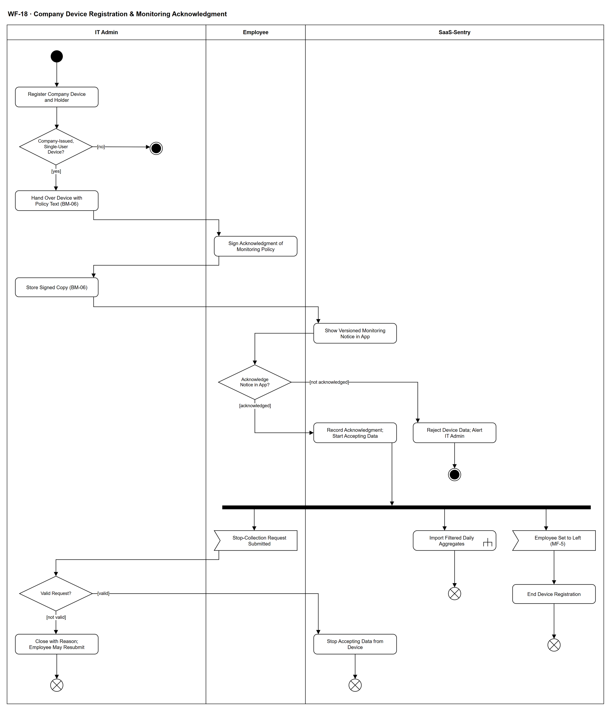

# WF-18 — Company Device Registration & Monitoring Acknowledgment

> **Loại:** Workflow hỗ trợ (cấp chi tiết) — nhóm SF-4 (bằng chứng sử dụng và tối ưu seat không dùng) · **Phiên bản:** 3.1 — 09/10/2026 · **Trạng thái:** Vẽ lại ở mức nghiệp vụ theo FR-4.18, FR-4.21, QĐ-57b, QĐ-58f, QĐ-59a; tính đủ pháp lý của chữ ký xác nhận còn mở (OQ-16, OQ-23, hoãn có điều kiện theo QĐ-59b) — sơ đồ không khẳng định tuân thủ; chờ Owner/GVHD review
>
> Sơ đồ là **dẫn xuất** từ quyết định Owner (`QĐ`) và BRD hiện hành; khi khác nhau, `QĐ` → BRD thắng. Quyết định trong sơ đồ là của Owner, **chưa** phải xác nhận của GVHD/hội đồng.

## 1. Mục đích và phạm vi

Mô tả việc **đăng ký thiết bị công ty và bảo đảm nhân viên biết rõ, xác nhận chủ động trước khi nhận bất kỳ dữ liệu nào từ máy**. Không có xác nhận thì không có dữ liệu (INV-17) và IT Admin thấy cảnh báo; máy cá nhân và máy dùng chung không bao giờ đăng ký; nhân viên có thể yêu cầu dừng thu thập và yêu cầu hợp lệ luôn được thực hiện. Đây là điều kiện nghiệp vụ và quyền riêng tư cho nguồn bằng chứng từ thiết bị công ty.

**Phạm vi:** Đăng ký thiết bị và người giữ, kiểm tra máy công ty cấp và không dùng chung, bàn giao kèm văn bản BM-06 xác nhận đã biết rõ, lưu bản ký, thông báo có phiên bản trong ứng dụng, xác nhận chủ động, từ chối dữ liệu và cảnh báo khi chưa xác nhận, nhận dữ liệu tổng hợp đã lọc tại nguồn (gọi WF-12), yêu cầu dừng thu thập (2 ngày làm việc), kết thúc đăng ký khi nghỉ việc.

**Không nằm trong sơ đồ này:** Loại bộ thu thập cụ thể, cách thu, ma trận nhà cung cấp (tệp nghiên cứu tool & vendor, giai đoạn Tools — QĐ-59a); đọc, khớp và ghi dữ liệu usage (→ WF-12, WF-12a); nghĩa vụ ngoài phần mềm: hồ sơ đánh giá tác động trong 60 ngày, nội quy lao động, xử lý vi phạm (BRD 7.7.5, ĐK-07, ĐK-10); quyền xem, xuất, chỉnh sửa dữ liệu của nhân viên (FR-10.1–10.7).

## 2. Tệp

| Tệp | Vai trò |
| --- | --- |
| [WF-18-company-device-registration-monitoring-acknowledgment.drawio](WF-18-company-device-registration-monitoring-acknowledgment.drawio) | Nguồn draw.io chỉnh sửa được (sinh từ spec) |
| [WF-18-company-device-registration-monitoring-acknowledgment.drawio.png](WF-18-company-device-registration-monitoring-acknowledgment.drawio.png) | Bản xuất PNG, nhúng sẵn nguồn draw.io |
| [WF-18.json](../specs/WF-18.json) | **Nguồn canonical** — sửa ở đây rồi chạy `python tools/flowkit.py build` từ `Docs/Diagrams` |

## 3. Nguồn nghiệp vụ

| Mã | Nội dung dùng trong sơ đồ |
| --- | --- |
| `FR-4.18, INV-17` | Đăng ký thiết bị, xác nhận chủ động lưu phiên bản + thời điểm, chưa xác nhận thì không nhận dữ liệu, nút dừng thu thập, nghỉ việc thì đăng ký hết hiệu lực |
| `FR-4.21, QĐ-57b, QĐ-58f` | Ký văn bản xác nhận đã biết rõ (BM-06); chỉ dùng trên máy công ty; sổ thiết bị không lưu IP; hệ thống không chặn kỹ thuật và không xử lý kỷ luật |
| `OI-14d` | Thiết bị dùng chung không đăng ký thu thập |
| `FR-10.4, QĐ-20` | Thông báo trước và xác nhận chủ động (thông báo đơn thuần không đủ) |
| `FR-10.5, OI-01a/b/c` | Yêu cầu dừng thu thập: 2 ngày làm việc, yêu cầu hợp lệ luôn được thực hiện, IT tự xử lý được |
| `ADR-13, ĐK-01 → ĐK-10` | Lọc tại nguồn; máy chủ không nhận dữ liệu thô; mười điều kiện triển khai |
| `FR-4.14a` | Bằng chứng từ bộ thu thập chỉ có điều kiện |
| `FR-5.14` | Cảnh báo máy công ty chưa có xác nhận chính sách gửi IT Admin |
| `OQ-16, OQ-23, QĐ-59b` | Chữ ký có thay được sự đồng ý hay không — hoãn có điều kiện, không khẳng định tuân thủ |

## 4. Tác nhân, kích hoạt, điều kiện

| Làn (tiếng Anh trên hình) | Tác nhân | Trách nhiệm trong sơ đồ |
| --- | --- | --- |
| IT Admin | IT Admin | Đăng ký thiết bị, bàn giao máy, lưu bản ký, xử lý yêu cầu dừng thu thập |
| Employee | Employee | Ký văn bản xác nhận đã biết rõ, xác nhận chủ động trong ứng dụng, gửi yêu cầu dừng thu thập |
| SaaS-Sentry | SaaS-Sentry | Hiển thị thông báo có phiên bản, ghi xác nhận, từ chối dữ liệu và cảnh báo, nhận dữ liệu, kết thúc đăng ký |

- **Kích hoạt:** Doanh nghiệp bàn giao một máy công ty cho nhân viên và IT Admin đăng ký thiết bị.
- **Tiền điều kiện:** Nhân viên đang làm việc; thiết bị do công ty cấp và chỉ một người dùng; ứng dụng liên lạc không nằm trong danh sách được thu (ADR-10).
- **Hậu điều kiện:** Hoặc: thiết bị đăng ký, bản ký BM-06 được lưu, xác nhận chủ động được ghi (phiên bản + thời điểm), dữ liệu tổng hợp đã lọc được nhận. Hoặc: không đăng ký (máy cá nhân/dùng chung); hoặc chưa xác nhận nên không có dữ liệu và IT được cảnh báo. Sau đó: dừng nhận dữ liệu khi yêu cầu dừng hợp lệ được xử lý, hoặc khi nhân viên nghỉ việc.

## 5. Cách đọc ký hiệu

| Ký hiệu | Nghĩa |
| --- | --- |
| Hình tròn đặc | Bắt đầu hoạt động (initial node) |
| Hình chữ nhật bo góc | Hành động (action) của tác nhân ở làn chứa nó |
| Hình chữ nhật bo góc có ký hiệu cây đinh ba ở góc | Gọi workflow con (call behavior) — mã workflow ghi trong nhãn |
| Hình thoi có chữ | Rẽ nhánh; mỗi cạnh ra mang điều kiện trong ngoặc vuông `[...]` |
| Thanh đen ngang | Tách hoặc gộp các nhánh chạy song song (fork/join) |
| Hình năm cạnh lõm | Chờ một sự kiện từ bên ngoài luồng (accept event) |
| Vòng tròn kép đặc | Kết thúc toàn bộ hoạt động (activity final) |
| Vòng tròn có dấu nhân | Kết thúc riêng nhánh đó, các nhánh khác vẫn chạy (flow final) |
| Dây có cung nhảy | Hai dây giao nhau nhưng **không** nối với nhau |

Phần trên là bàn giao và xác nhận theo thứ tự: đăng ký, bàn giao, ký, lưu, thông báo, xác nhận. Sau khi xác nhận, thanh tách mở ba nhánh song song: nhận dữ liệu (gọi WF-12), xử lý yêu cầu dừng thu thập, và kết thúc đăng ký khi nghỉ việc. Chưa xác nhận là kết cục hợp lệ không có đường vòng để thu thập.

## 6. Bảng node

| ID | Loại | Nhãn trên hình | Ý nghĩa | Làn / người thực hiện | Quy tắc |
| --- | --- | --- | --- | --- | --- |
| `st` | Nút bắt đầu | — | — | IT Admin | — |
| `a_reg` | Hành động | Register Company Device and Holder | IT Admin ghi vào sổ thiết bị: mã tài sản, hệ điều hành, tên máy, người giữ, khoảng hiệu lực. Không lưu địa chỉ IP (thay đổi liên tục và là dữ liệu cá nhân). Một nhân viên có thể có nhiều thiết bị đăng ký, mỗi thiết bị xác nhận riêng. | IT Admin | `FR-4.18`, `FR-4.21`, `QĐ-57b`, `ADR-04` |
| `d_dev` | Rẽ nhánh | Company-Issued, Single-User Device? | Thiết bị do công ty cấp và chỉ một người dùng. Máy cá nhân không đăng ký và không bị thu dữ liệu; thiết bị dùng chung nhiều người không được đăng ký thu thập (điểm mù có ghi nhận). Hệ thống không chặn kỹ thuật việc dùng dịch vụ trên máy cá nhân. | IT Admin | `FR-4.21`, `OI-14d`, `ĐK-01`, `QĐ-58f` |
| `end_not` | Kết thúc hoạt động | — | Không đăng ký thiết bị; không có thu thập từ thiết bị này (máy cá nhân hoặc dùng chung). | IT Admin | — |
| `a_hand` | Hành động | Hand Over Device with Policy Text (BM-06) | Bàn giao máy kèm văn bản chính sách thiết bị và theo dõi (mẫu ở Phụ lục D.2): dịch vụ công ty cấp chỉ dùng trên máy công ty; dữ liệu thu, không thu, mục đích, ai xem, thời hạn lưu, quyền dừng thu thập. | IT Admin | `FR-4.21`, `BM-06`, `QĐ-58f` |
| `a_sign` | Hành động | Sign Acknowledgment of Monitoring Policy | Nhân viên ký văn bản **BM-06** *xác nhận đã biết rõ* chính sách theo dõi trên máy (không phải đồng ý) **tại bàn giao máy, ngoài ứng dụng**; không phải chữ ký số (QĐ-53a). IT Admin lưu bản ký; xác nhận trong ứng dụng là bước riêng sau đó (FR-4.21(1)). Việc chữ ký có thay được sự đồng ý theo luật hay không còn là câu hỏi pháp lý mở. | Employee | `BM-06`, `FR-4.21`, `OQ-16`, `OQ-23`, `QĐ-53a` |
| `a_store` | Hành động | Store Signed Copy (BM-06) | IT Admin lưu bản ký gắn với thiết bị và nhân viên; hồ sơ không sửa sau khi đã có quyết định, giữ cùng thời hạn với dữ liệu nó làm căn cứ. | IT Admin | `FR-4.21`, `BM-06`, `FR-1.5`, `FR-11.2` |
| `s_notice` | Hành động | Show Versioned Monitoring Notice in App | Hệ thống hiển thị thông báo theo dõi mức độ sử dụng (nội dung có phiên bản) cho nhân viên trước khi nhận bất kỳ dữ liệu nào từ thiết bị. Thông báo đơn thuần là không đủ: cần xác nhận chủ động. Thông báo có **phiên bản**: khi Super Admin đánh dấu phiên bản mới *cần xác nhận lại* (đổi loại dữ liệu hoặc mục đích), hệ thống ngừng nhận dữ liệu từ thiết bị tới khi nhân viên xác nhận lại phiên bản đó; phiên bản chỉ sửa câu chữ thì chỉ thông báo (QĐ-62q, INV-17). | SaaS-Sentry | `FR-10.4`, `FR-4.18`, `ND-3`, `QĐ-20`, `QĐ-62q` |
| `d_ack` | Rẽ nhánh | Acknowledge Notice in App? | Nhân viên bấm xác nhận chủ động trong hệ thống hay chưa. Im lặng không phải là xác nhận. Xác nhận gắn với phiên bản thông báo; phiên bản đánh dấu *cần xác nhận lại* phải được xác nhận lại (QĐ-62q). | Employee | `FR-4.18`, `INV-17`, `ĐK-03` |
| `s_rec` | Hành động | Record Acknowledgment; Start Accepting Data | Lưu bản ghi xác nhận gồm phiên bản nội dung thông báo và thời điểm, rồi bắt đầu nhận dữ liệu từ thiết bị. Nội dung thông báo đổi thì xác nhận lại theo phiên bản mới (chưa nêu rõ trong BRD). | SaaS-Sentry | `FR-4.18`, `INV-17` |
| `s_alert` | Hành động | Reject Device Data; Alert IT Admin | Chưa xác nhận thì không nhận dữ liệu từ thiết bị (máy chủ từ chối bản ghi từ thiết bị chưa đăng ký hoặc nhân viên chưa xác nhận) và IT Admin thấy cảnh báo máy công ty chưa có xác nhận chính sách. | SaaS-Sentry | `INV-17`, `FR-4.21`, `FR-5.14`, `ADR-13` |
| `end_noack` | Kết thúc hoạt động | — | Không có dữ liệu nào được nhận từ thiết bị; IT Admin đã được cảnh báo. Đây là kết cục hợp lệ, không phải lỗi. | SaaS-Sentry | — |
| `f_par` | Tách song song | — | — | SaaS-Sentry | — |
| `c_wf12` | Gọi workflow con | Import Filtered Daily Aggregates | Thiết bị đã xác nhận gửi tổng hợp theo ngày đã lọc tại nguồn; máy chủ không bao giờ nhận dữ liệu thô (URL, tiêu đề, nội dung, phím bấm, ảnh màn hình, địa chỉ IP, ứng dụng liên lạc) và từ chối trường ngoài lược đồ. Dữ liệu này chỉ là bằng chứng có điều kiện, không đứng một mình để kết luận G3/G4. Loại bộ thu thập cụ thể do giai đoạn Tools chốt. | SaaS-Sentry | `ADR-13`, `INV-17`, `FR-4.14a`, `ĐK-04`, `ĐK-05`, `ĐK-06`, `QĐ-59a`, → `WF-12` |
| `ff_imp` | Kết thúc nhánh (flow final) | — | Nhánh nhận dữ liệu kết thúc (tiếp tục theo lịch của WF-12). | SaaS-Sentry | — |
| `e_stop` | Chờ sự kiện | Stop-Collection Request Submitted | Nhân viên bấm nút yêu cầu dừng thu thập trên thiết bị đã đăng ký; yêu cầu được ghi nhận kèm thời điểm tiếp nhận. Gửi yêu cầu không đồng nghĩa dừng ngay. | Employee | `FR-4.18`, `FR-10.5`, `OI-01a` |
| `d_valid` | Rẽ nhánh | Valid Request? | IT Admin xử lý trong 2 ngày làm việc (cấu hình được). Yêu cầu hợp lệ luôn được thực hiện; chỉ yêu cầu không hợp lệ (không phải thiết bị của mình, trùng, đã dừng) bị đóng kèm lý do. IT được tự xử lý yêu cầu của chính mình, Audit Trail gắn cờ tự xử lý. | IT Admin | `FR-10.5`, `OI-01a`, `OI-01b`, `OI-01c` |
| `s_stop` | Hành động | Stop Accepting Data from Device | Thiết bị ngừng được nhận dữ liệu khi yêu cầu được xử lý. Hệ quả của việc dừng đối với công việc theo nội quy lao động do doanh nghiệp quyết, ngoài phạm vi hệ thống. | SaaS-Sentry | `FR-10.5`, `FR-4.18`, `FR-4.21` |
| `ff_stop` | Kết thúc nhánh (flow final) | — | Nhánh xử lý yêu cầu dừng kết thúc: thiết bị không còn gửi dữ liệu. | SaaS-Sentry | — |
| `a_close` | Hành động | Close with Reason; Employee May Resubmit | Yêu cầu không hợp lệ bị đóng kèm lý do; nhân viên gửi lại được. MVP không có luồng kháng nghị. | IT Admin | `FR-10.5`, `OI-01b` |
| `ff_close` | Kết thúc nhánh (flow final) | — | Nhánh xử lý yêu cầu kết thúc, thiết bị vẫn đăng ký. | IT Admin | — |
| `e_leave` | Chờ sự kiện | Employee Set to Left (MF-5) | Nhân viên chuyển sang trạng thái đã nghỉ việc ở luồng nghỉ việc. | SaaS-Sentry | `FR-4.18`, `FR-8.9` |
| `s_end` | Hành động | End Device Registration | Đăng ký thiết bị hết hiệu lực nên không nhận thêm dữ liệu từ thiết bị đó; dữ liệu hoạt động chi tiết được xóa theo lịch của luồng nghỉ việc. | SaaS-Sentry | `FR-4.18`, `FR-10.6` |
| `ff_leave` | Kết thúc nhánh (flow final) | — | Nhánh nghỉ việc kết thúc. | SaaS-Sentry | — |

## 7. Bảng chuyển tiếp

| Từ → tới | Nhãn điều kiện | Điều kiện | Kết quả |
| --- | --- | --- | --- |
| `st` → `a_reg` | — | — | Sang Register Company Device and Holder |
| `a_reg` → `d_dev` | — | — | Sang Company-Issued, Single-User Device? |
| `d_dev` → `a_hand` | `[yes]` | Máy công ty cấp, một người dùng | Bàn giao máy |
| `d_dev` → `end_not` | `[no]` | Máy cá nhân hoặc dùng chung | Không đăng ký |
| `a_hand` → `a_sign` | — | — | Sang Sign Acknowledgment of Monitoring Policy |
| `a_sign` → `a_store` | — | — | Sang Store Signed Copy (BM-06) |
| `a_store` → `s_notice` | — | — | Sang Show Versioned Monitoring Notice in App |
| `s_notice` → `d_ack` | — | — | Sang Acknowledge Notice in App? |
| `d_ack` → `s_rec` | `[acknowledged]` | Nhân viên xác nhận chủ động | Ghi xác nhận |
| `d_ack` → `s_alert` | `[not acknowledged]` | Chưa xác nhận | Từ chối dữ liệu và cảnh báo |
| `s_alert` → `end_noack` | — | — | Sang — |
| `s_rec` → `f_par` | — | — | Sang — |
| `f_par` → `c_wf12` | — | — | Nhánh nhận dữ liệu |
| `f_par` → `e_stop` | — | — | Nhánh yêu cầu dừng thu thập |
| `f_par` → `e_leave` | — | — | Nhánh nghỉ việc |
| `c_wf12` → `ff_imp` | — | — | Sang — |
| `e_stop` → `d_valid` | — | — | Sang Valid Request? |
| `d_valid` → `s_stop` | `[valid]` | Yêu cầu hợp lệ | Dừng nhận dữ liệu |
| `d_valid` → `a_close` | `[not valid]` | Không phải thiết bị của mình, trùng hoặc đã dừng | Đóng kèm lý do |
| `s_stop` → `ff_stop` | — | — | Sang — |
| `a_close` → `ff_close` | — | — | Sang — |
| `e_leave` → `s_end` | — | — | Sang End Device Registration |
| `s_end` → `ff_leave` | — | — | Sang — |

Số đếm: **24 node · 23 cạnh · 3 rẽ nhánh**; giao cắt dây: **0**.

## 8. Happy path

1. `st` — —
2. `a_reg` — Register Company Device and Holder: IT Admin ghi vào sổ thiết bị: mã tài sản, hệ điều hành, tên máy, người giữ, khoảng hiệu lực. Không lưu địa chỉ IP (thay đổi liên tục và là dữ liệu cá nhân). Một nhân viên có thể có nhiều thiết bị đăng ký, mỗi thiết bị xác nhận riêng.
3. `d_dev` — Company-Issued, Single-User Device?: Thiết bị do công ty cấp và chỉ một người dùng. Máy cá nhân không đăng ký và không bị thu dữ liệu; thiết bị dùng chung nhiều người không được đăng ký thu thập (điểm mù có ghi nhận). Hệ thống không chặn kỹ thuật việc dùng dịch vụ trên máy cá nhân.
4. `a_hand` — Hand Over Device with Policy Text (BM-06): Bàn giao máy kèm văn bản chính sách thiết bị và theo dõi (mẫu ở Phụ lục D.2): dịch vụ công ty cấp chỉ dùng trên máy công ty; dữ liệu thu, không thu, mục đích, ai xem, thời hạn lưu, quyền dừng thu thập.
5. `a_sign` — Sign Acknowledgment of Monitoring Policy: Nhân viên ký văn bản **BM-06** *xác nhận đã biết rõ* chính sách theo dõi trên máy (không phải đồng ý) **tại bàn giao máy, ngoài ứng dụng**; không phải chữ ký số (QĐ-53a). IT Admin lưu bản ký; xác nhận trong ứng dụng là bước riêng sau đó (FR-4.21(1)). Việc chữ ký có thay được sự đồng ý theo luật hay không còn là câu hỏi pháp lý mở.
6. `a_store` — Store Signed Copy (BM-06): IT Admin lưu bản ký gắn với thiết bị và nhân viên; hồ sơ không sửa sau khi đã có quyết định, giữ cùng thời hạn với dữ liệu nó làm căn cứ.
7. `s_notice` — Show Versioned Monitoring Notice in App: Hệ thống hiển thị thông báo theo dõi mức độ sử dụng (nội dung có phiên bản) cho nhân viên trước khi nhận bất kỳ dữ liệu nào từ thiết bị. Thông báo đơn thuần là không đủ: cần xác nhận chủ động. Thông báo có **phiên bản**: khi Super Admin đánh dấu phiên bản mới *cần xác nhận lại* (đổi loại dữ liệu hoặc mục đích), hệ thống ngừng nhận dữ liệu từ thiết bị tới khi nhân viên xác nhận lại phiên bản đó; phiên bản chỉ sửa câu chữ thì chỉ thông báo (QĐ-62q, INV-17).
8. `d_ack` — Acknowledge Notice in App?: Nhân viên bấm xác nhận chủ động trong hệ thống hay chưa. Im lặng không phải là xác nhận. Xác nhận gắn với phiên bản thông báo; phiên bản đánh dấu *cần xác nhận lại* phải được xác nhận lại (QĐ-62q).
9. `s_rec` — Record Acknowledgment; Start Accepting Data: Lưu bản ghi xác nhận gồm phiên bản nội dung thông báo và thời điểm, rồi bắt đầu nhận dữ liệu từ thiết bị. Nội dung thông báo đổi thì xác nhận lại theo phiên bản mới (chưa nêu rõ trong BRD).
10. `f_par` — —
11. `c_wf12` — Import Filtered Daily Aggregates: Thiết bị đã xác nhận gửi tổng hợp theo ngày đã lọc tại nguồn; máy chủ không bao giờ nhận dữ liệu thô (URL, tiêu đề, nội dung, phím bấm, ảnh màn hình, địa chỉ IP, ứng dụng liên lạc) và từ chối trường ngoài lược đồ. Dữ liệu này chỉ là bằng chứng có điều kiện, không đứng một mình để kết luận G3/G4. Loại bộ thu thập cụ thể do giai đoạn Tools chốt.
12. `ff_imp` — —: Nhánh nhận dữ liệu kết thúc (tiếp tục theo lịch của WF-12).

## 9. Nhánh thay thế / if-else

- **Yêu cầu dừng thu thập hợp lệ** — `f_par` → `e_stop` → `d_valid` → `s_stop` → `ff_stop`. Thiết bị ngừng được nhận dữ liệu; xử lý trong 2 ngày làm việc.
- **Nhân viên nghỉ việc** — `f_par` → `e_leave` → `s_end` → `ff_leave`. Đăng ký thiết bị hết hiệu lực.

## 10. Nhánh lỗi / từ chối và cách kết thúc

- **Máy cá nhân hoặc dùng chung** — `d_dev` → `end_not`. Không đăng ký, không thu.
- **Chưa xác nhận chủ động** — `d_ack` → `s_alert` → `end_noack`. Không nhận dữ liệu; IT Admin thấy cảnh báo (INV-17).
- **Yêu cầu dừng không hợp lệ** — `d_valid` → `a_close` → `ff_close`. Đóng kèm lý do; nhân viên gửi lại được.

## 11. Liên hệ với sơ đồ khác

- Cấp trên: nhóm SF-4 (trước đây MF-3); Context (đăng ký thiết bị, xác nhận), FDD Feature 4 và 7
- `WF-12` — nhận và ghi dữ liệu tổng hợp từ thiết bị đã xác nhận (node gọi)
- `MF-5` — nghỉ việc kết thúc đăng ký thiết bị
- User flow: `UF-16`
- `WF-12` — gọi/chuyển tại node `c_wf12`

## 12. Giới hạn và vấn đề còn mở

- (DEFERRED/OUT · DOI-13, QĐ-59b) Chữ ký BM-06 kèm xác nhận trong hệ thống có thay được sự đồng ý tự nguyện theo luật hay không là câu hỏi pháp lý hoãn có điều kiện (OQ-16, OQ-23); sơ đồ chỉ thể hiện biện pháp thiết kế, không khẳng định tuân thủ.
- (LATER-TECH/UI · DOI-74) Nhịp nhắc khi nhân viên chưa xác nhận là tham số thiết kế; xác nhận muộn ⟹ chỉ nhận dữ liệu từ thời điểm xác nhận (INV-17 *tại thời điểm ghi nhận*).
- (ĐÃ CHỐT · DOI-75, QĐ-62q) Phiên bản thông báo đổi loại dữ liệu hoặc mục đích ⟹ phải xác nhận lại trước khi nhận dữ liệu tiếp; chỉ sửa câu chữ ⟹ chỉ thông báo.
- (LIMIT · DOI-15, FR-4.21, FR-10.5) Hệ quả của việc dừng thu thập theo nội quy lao động do doanh nghiệp quyết, ngoài phạm vi hệ thống.
- (LIMIT · DOI-14, OI-14d) Thiết bị dùng chung nhiều người là điểm mù được ghi nhận, chưa có chỗ ghi trong sơ đồ.
- (DEFERRED/OUT · DOI-09, QĐ-59a) Loại bộ thu thập và cách báo bao phủ do giai đoạn Tools chốt; sơ đồ chỉnh nếu quy tắc nhận dữ liệu thay đổi.
