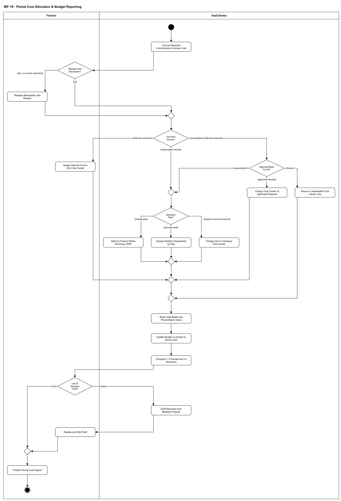

# WF-19 — Period Cost Allocation & Budget Reporting

> **Loại:** Workflow chi tiết (detail) của MF-8 — các bước sau khi đối chiếu hóa đơn · **Phiên bản:** 1.1 — 09/10/2026 · **Trạng thái:** Mới — vẽ theo BRD v3.30 (đồng bộ QĐ-61/QĐ-62) FR-5.1→5.13, QĐ-49e/g, QĐ-50c, QĐ-55b, QĐ-60a, OI-03, OI-11a; chờ Owner/GVHD review
>
> Sơ đồ là **dẫn xuất** từ quyết định Owner (`QĐ`) và BRD hiện hành; khi khác nhau, `QĐ` → BRD thắng. Quyết định trong sơ đồ là của Owner, **chưa** phải xác nhận của GVHD/hội đồng.

## 1. Mục đích và phạm vi

Khép chi phí của một kỳ ở mức chi tiết: chuyển khoản cam kết đã khớp thành chi phí, quy **mọi** khoản chi phí về đúng Cost Center theo quy tắc, dựng hai cơ sở ghi nhận, cập nhật Budget vs Actual trên **chi phí thực chịu**, dự báo và phát hành báo cáo theo đúng phạm vi xem của từng vai.

**Phạm vi:** Chuyển cam kết (kể cả khớp một phần và giải phóng phần dư); phân bổ theo loại khoản (thuê bao: tỷ lệ gói dùng chung / seat cá nhân chia theo ngày / tài khoản dùng chung hoặc dịch vụ; chi phí nội bộ một Cost Center; phần sao kê chưa có hóa đơn theo căn cứ hoặc dòng Chưa phân bổ); hai cơ sở dòng tiền/theo kỳ; đa tiền tệ; Budget vs Actual; dự báo L1 + L3; bản nháp AI tùy chọn; phát hành.

**Không nằm trong sơ đồ này:** Ghi hóa đơn, đối chiếu và sai lệch (→ WF-16); đối soát khoản chi sao kê và ngoại lệ (→ WF-17); lập ngân sách, danh mục Cost Center và gắn ngược cam kết (→ WF-20). Không thanh toán, sổ cái, kết nối ngân hàng; thuế chỉ ghi nhận, không tính/kê khai (QĐ-34, QĐ-55a). Dự báo L2 không hiện thực (QĐ-25).

## 2. Tệp

| Tệp | Vai trò |
| --- | --- |
| [WF-19-period-cost-allocation-budget-reporting.drawio](WF-19-period-cost-allocation-budget-reporting.drawio) | Nguồn draw.io chỉnh sửa được (sinh từ spec) |
| [WF-19-period-cost-allocation-budget-reporting.drawio.png](WF-19-period-cost-allocation-budget-reporting.drawio.png) | Bản xuất PNG, nhúng sẵn nguồn draw.io |
| [WF-19.json](../specs/WF-19.json) | **Nguồn canonical** — sửa ở đây rồi chạy `python tools/flowkit.py build` từ `Docs/Diagrams` |

## 3. Nguồn nghiệp vụ

| Mã | Nội dung dùng trong sơ đồ |
| --- | --- |
| `FR-5.8, OI-11a` | Chuyển cam kết theo số tiền hóa đơn, khớp một phần, giải phóng phần dư kèm lý do |
| `FR-5.2, INV-03, OI-03` | Phân bổ theo Cost Center; gói dùng chung theo tỷ lệ tổng 100% |
| `FR-2.11, QĐ-54d, QĐ-52b` | Tài khoản dùng chung của phòng → Unit; toàn công ty và tài khoản dịch vụ → Company |
| `FR-5.3, QĐ-55b, ADR-04` | Hai cơ sở ghi nhận; chia theo ngày khi điều chuyển |
| `QĐ-49g` | Chi phí nội bộ đúng một Cost Center |
| `QĐ-50c` | Phần sao kê chưa có hóa đơn: theo căn cứ hoặc dòng Chưa phân bổ Cost Center |
| `FR-5.6, INV-04` | Đa tiền tệ theo tỷ giá tại ngày giao dịch |
| `FR-5.1, FR-5.13, QĐ-60a` | Budget vs Actual trên chi phí thực chịu; GTGT được khấu trừ cột riêng; chênh lệch thuế/tỷ giá tách riêng |
| `FR-5.8a` | Còn lại được phép âm, nhãn đã cam kết vượt hạn mức |
| `FR-5.5→5.7, QĐ-25` | Dự báo L1 công thức, L3 kịch bản, L2 không hiện thực |
| `FR-5.9→5.12, BRD 5.5.3` | Năm nhóm báo cáo và bảng ai xem báo cáo nào |
| `QĐ-49e` | Bản nháp diễn giải AI tùy chọn, Finance sửa |

## 4. Tác nhân, kích hoạt, điều kiện

| Làn (tiếng Anh trên hình) | Tác nhân | Trách nhiệm trong sơ đồ |
| --- | --- | --- |
| Finance | Finance (một người) | Giải phóng phần dư khoản cam kết, gán Cost Center cho chi phí nội bộ, chọn và sửa bản nháp AI, phát hành báo cáo |
| SaaS-Sentry | SaaS-Sentry | Chuyển cam kết, áp quy tắc phân bổ, dựng hai cơ sở, Budget vs Actual, dự báo, soạn nháp AI |

- **Kích hoạt:** Hóa đơn của kỳ đã được ghi và đối chiếu (WF-16), khoản chi sao kê đã đối soát (WF-17, nếu có); Finance khép kỳ.
- **Tiền điều kiện:** Cost Center và ngân sách của kỳ (có thể chưa có — FR-5.8a); quan hệ nhân viên–phòng có hiệu lực theo thời gian; tỷ lệ gói dùng chung đã khai; tỷ giá tại ngày giao dịch đã lưu trên từng số tiền (INV-04).
- **Hậu điều kiện:** Mọi khoản chi phí của kỳ thuộc đúng một Cost Center hoặc dòng Chưa phân bổ; khoản cam kết khớp đã thành chi phí theo số tiền; báo cáo kỳ phát hành trên chi phí thực chịu, mỗi vai thấy đúng phạm vi của mình.

## 5. Cách đọc ký hiệu

| Ký hiệu | Nghĩa |
| --- | --- |
| Hình tròn đặc | Bắt đầu hoạt động (initial node) |
| Hình chữ nhật bo góc | Hành động (action) của tác nhân ở làn chứa nó |
| Hình thoi có chữ | Rẽ nhánh; mỗi cạnh ra mang điều kiện trong ngoặc vuông `[...]` |
| Hình thoi nhỏ không chữ | Hợp nhánh (merge) |
| Vòng tròn kép đặc | Kết thúc toàn bộ hoạt động (activity final) |
| Dây có cung nhảy | Hai dây giao nhau nhưng **không** nối với nhau |

Cột giữa của làn hệ thống là trục chính. *Cost Item Source?* tách ba loại khoản: thuê bao (xuống *Allocation Rule?*), chi phí nội bộ (sang Finance), phần sao kê chưa có hóa đơn (sang phải, theo căn cứ — căn cứ là thuê bao thì quay về quy tắc của thuê bao). Ba hình thoi nhỏ chỉ gom kết quả phân bổ trước khi dựng báo cáo.

## 6. Bảng node

| ID | Loại | Nhãn trên hình | Ý nghĩa | Làn / người thực hiện | Quy tắc |
| --- | --- | --- | --- | --- | --- |
| `st` | Nút bắt đầu | — | — | SaaS-Sentry | — |
| `s_conv` | Hành động | Convert Matched Commitments to Actual Cost | Mỗi hóa đơn đã đối soát khớp chuyển đúng số tiền của nó từ khoản cam kết *Đang giữ* thành chi phí; khớp một phần thì phần còn lại vẫn *Đang giữ*, hết số còn lại thì *Đã thành chi phí*. Không trừ hai lần. Khoản chi sao kê khớp khoản cam kết khi chưa có hóa đơn **không** đổi trạng thái khoản cam kết. | SaaS-Sentry | `FR-5.8`, `OI-11a`, `QĐ-50c`, `QĐ-24` |
| `d_rem` | Rẽ nhánh | Release Held Remainder? | Với khoản cam kết còn phần dư đang giữ mà không còn hóa đơn nào sẽ đến, Finance có thể giải phóng phần dư. | Finance | `FR-5.8`, `OI-11a` |
| `a_rel` | Hành động | Release Remainder with Reason | Finance giải phóng phần dư của khoản cam kết kèm lý do bắt buộc; ghi Audit Trail. | Finance | `FR-5.8`, `OI-11a` |
| `m_c` | Hợp nhánh | — | — | SaaS-Sentry | — |
| `d_type` | Rẽ nhánh | Cost Item Source? | Ba loại khoản chi phí của kỳ: hóa đơn của thuê bao · khoản chi phí phần mềm nội bộ · phần khoản chi trên sao kê chưa được hóa đơn nào giải thích. | SaaS-Sentry | `FR-5.2`, `QĐ-49g`, `QĐ-50c` |
| `a_int` | Hành động | Assign Internal Cost to One Cost Center | Khoản chi phí phần mềm nội bộ (không cần hóa đơn, thuê bao hay nhà cung cấp) được Finance gán cho đúng một Cost Center; muốn chia thì ghi nhiều khoản. Không áp tỷ lệ phân bổ. | Finance | `QĐ-49g`, `FR-5.2` |
| `d_basis` | Rẽ nhánh | Approval Basis Found? | Phần khoản chi chưa được hóa đơn giải thích vẫn là thực chi, không đếm hai lần. Đặt vào Cost Center theo căn cứ đã đối soát ở WF-17. | SaaS-Sentry | `QĐ-50c`, `FR-5.4` |
| `m_sub` | Hợp nhánh | — | — | SaaS-Sentry | — |
| `s_req` | Hành động | Charge Cost Center of Approved Request | Căn cứ là khoản cam kết của yêu cầu đã duyệt: tính vào Cost Center của yêu cầu đó; khoản cam kết giữ nguyên trạng thái (chỉ hóa đơn mới chuyển *Đã thành chi phí*). | SaaS-Sentry | `QĐ-50c`, `FR-5.8` |
| `s_unal` | Hành động | Show on Unallocated Cost Center Line | Chưa có căn cứ: hiện ở dòng riêng *Chưa phân bổ Cost Center* trong thực chi của kỳ, không ép vào Cost Center nào; ngoại lệ vẫn mở tới khi Người duyệt chi quyết (WF-17). Dòng này là dòng báo cáo, không phải một bản ghi Cost Center. | SaaS-Sentry | `QĐ-50c`, `FR-5.2`, `FR-9.7` |
| `d_alloc` | Rẽ nhánh | Allocation Rule? | Quy tắc phân bổ của thuê bao: gói dùng chung theo tỷ lệ · seat của người dùng cá nhân · tài khoản dùng chung hoặc tài khoản dịch vụ (Cost Center ghi trên Assignment). | SaaS-Sentry | `FR-5.2`, `INV-03`, `FR-2.11` |
| `s_ratio` | Hành động | Split by Finance Ratios Summing 100% | Gói dùng chung: chia theo tỷ lệ và hiệu lực do Finance khai; tổng tỷ lệ của một thuê bao luôn bằng 100%. Tỷ lệ chỉ áp cho Subscription. | SaaS-Sentry | `INV-03`, `OI-03`, `QĐ-49g` |
| `s_seat` | Hành động | Charge Holder's Department by Day | Seat cá nhân: tính vào Cost Center Unit của phòng có hiệu lực của người giữ seat tại ngày chi phí. Điều chuyển trong kỳ ⟹ chi phí theo kỳ chia theo ngày (Figma 15 USD/tháng, hiệu lực 16/10 ⟹ 1–15/10 phòng A, 16–31/10 phòng B); chi phí đã phát sinh không bị viết lại. | SaaS-Sentry | `FR-5.2`, `FR-5.3`, `QĐ-55b`, `ADR-04`, `QĐ-52a` |
| `s_acct` | Hành động | Charge Unit or Company Cost Center | Tài khoản dùng chung của một phòng ⟹ Cost Center Unit của phòng đó; tài khoản dùng chung toàn công ty và tài khoản dịch vụ ⟹ Cost Center Company. | SaaS-Sentry | `FR-2.11`, `QĐ-54d`, `QĐ-40d`, `QĐ-52b` |
| `m_a1` | Hợp nhánh | — | — | SaaS-Sentry | — |
| `m_a2` | Hợp nhánh | — | — | SaaS-Sentry | — |
| `m_a3` | Hợp nhánh | — | — | SaaS-Sentry | — |
| `s_bases` | Hành động | Build Cash-Basis and Period-Basis Views | Hai cơ sở có nhãn rõ: theo dòng tiền (tại ngày hóa đơn, Cost Center tại ngày hóa đơn, không đổi) và theo kỳ (phân bổ đều theo thời gian sử dụng, chia theo ngày khi điều chuyển). Mọi số tiền quy đổi về đồng tiền báo cáo theo tỷ giá chốt tại ngày giao dịch, không quy đổi lại khi xem. | SaaS-Sentry | `FR-5.3`, `FR-5.6`, `QĐ-55b`, `INV-04` |
| `s_report` | Hành động | Update Budget vs Actual on Borne Cost | Theo Cost Center và kỳ ngân sách: ngân sách · thực chi · cam kết đang giữ · còn lại (= ngân sách − thực chi − cam kết đang giữ), trên chi phí thực chịu (giá + thuế không được khấu trừ + phí thẻ/chênh tỷ giá); GTGT được khấu trừ ở cột riêng, không trừ vào ngân sách; chênh lệch do thuế/tỷ giá/phí tách khỏi chênh lệch số lượng/đơn giá; dòng Chưa phân bổ Cost Center và ngoại lệ đang mở. Còn lại âm hiện kèm nhãn *đã cam kết vượt hạn mức*. Chưa có ngân sách hiện *Chưa có ngân sách*, không hiện 0. Kèm nhóm theo phòng, ứng dụng, nhà cung cấp. | SaaS-Sentry | `FR-5.1`, `FR-5.2`, `FR-5.13`, `QĐ-60a`, `QĐ-24`, `FR-5.8a` |
| `s_fc` | Hành động | Compute L1 Forecast and L3 Scenarios | L1 — chi phí đã cam kết: công thức xác định từ hợp đồng (số lượng, đơn giá, ngày gia hạn), không dùng mô hình thống kê. L3 — ba kịch bản từ giả định người dùng nhập. L2 (mô hình xu hướng có cổng kiểm chứng) chưa hiện thực: giao diện ghi rõ *dự báo theo mô hình chưa được hiện thực*, không để trống. | SaaS-Sentry | `FR-5.5`, `FR-5.7`, `QĐ-25`, `ADR-09` |
| `d_ai` | Rẽ nhánh | Use AI Narrative Draft? | Finance chọn dùng bản nháp diễn giải do AI soạn hay không. AI tắt hoặc lỗi thì không có lựa chọn này; quy trình vẫn chạy đủ. | Finance | `QĐ-49e(2)` |
| `s_ai` | Hành động | Draft Narrative from Backend Figures | AI chỉ diễn giải số liệu backend đã tính, mỗi con số truy được nguồn; không tính tiền, không kết luận vi phạm; chỉ dùng dữ liệu Finance được xem. | SaaS-Sentry | `QĐ-49e(2)`, `BRD 6.4` |
| `a_edit` | Hành động | Review and Edit Draft | Finance xem và sửa bản nháp trước khi dùng; bản nháp không phải số liệu. | Finance | `QĐ-49e(2)` |
| `m_pub` | Hợp nhánh | — | — | Finance | — |
| `a_pub` | Hành động | Publish Period Cost Report | Finance phát hành báo cáo kỳ. Phạm vi xem theo vai: Người duyệt chi — tổng chi, tiết kiệm, tóm tắt hiệu suất sử dụng và quy trình; Finance — tổng chi kèm khoản cam kết, tiết kiệm; IT Admin — tiết kiệm, hiệu suất sử dụng, quy trình, chất lượng (trừ KPI-5); Super Admin — quy trình, chất lượng gồm KPI-5; trưởng phòng — chỉ thực chi + cam kết đang giữ của phòng mình, không ngân sách, số còn lại hay tổng công ty. Finance không là người duyệt. Báo cáo đã phát hành là bản chụp bất biến có thời điểm; kỳ **không khóa** — khoản đến muộn hiện ở báo cáo sau dưới nhãn *điều chỉnh kỳ trước* (QĐ-62m). | Finance | `BRD 5.5.3`, `FR-5.10`, `FR-5.11`, `FR-5.12`, `FR-5.9`, `QĐ-62m`, `SoD-2`, `SoD-3`, `FR-0.3` |
| `end` | Kết thúc hoạt động | — | Chi phí của kỳ đã về đúng Cost Center; báo cáo kỳ phát hành trên chi phí thực chịu. | Finance | — |

## 7. Bảng chuyển tiếp

| Từ → tới | Nhãn điều kiện | Điều kiện | Kết quả |
| --- | --- | --- | --- |
| `st` → `s_conv` | — | — | Sang Convert Matched Commitments to Actual Cost |
| `s_conv` → `d_rem` | — | — | Sang Release Held Remainder? |
| `d_rem` → `a_rel` | `[yes, no invoice expected]` | Không còn hóa đơn nào sẽ đến cho phần dư | Giải phóng phần dư kèm lý do |
| `d_rem` → `m_c` | `[no]` | Còn chờ hóa đơn hoặc không có phần dư | Phần dư tiếp tục được giữ |
| `a_rel` → `m_c` | — | — | Sang — |
| `m_c` → `d_type` | — | — | Sang Cost Item Source? |
| `d_type` → `m_sub` | `[subscription invoice]` | Hóa đơn của thuê bao | Áp quy tắc phân bổ của thuê bao |
| `d_type` → `a_int` | `[internal cost item]` | Khoản chi phí phần mềm nội bộ | Finance gán đúng một Cost Center |
| `d_type` → `d_basis` | `[unexplained statement amount]` | Phần khoản chi sao kê chưa được hóa đơn giải thích | Đặt theo căn cứ |
| `d_basis` → `m_sub` | `[subscription]` | Căn cứ là thuê bao | Theo quy tắc phân bổ của thuê bao đó |
| `d_basis` → `s_req` | `[approved request]` | Căn cứ là khoản cam kết của yêu cầu đã duyệt | Cost Center của yêu cầu |
| `d_basis` → `s_unal` | `[none]` | Chưa có căn cứ | Dòng Chưa phân bổ Cost Center; ngoại lệ vẫn mở |
| `m_sub` → `d_alloc` | — | — | Sang Allocation Rule? |
| `d_alloc` → `s_ratio` | `[shared plan]` | Gói dùng chung | Chia theo tỷ lệ Finance khai |
| `d_alloc` → `s_seat` | `[personal seat]` | Seat cá nhân | Phòng của người giữ seat, chia theo ngày |
| `d_alloc` → `s_acct` | `[shared or service account]` | Tài khoản dùng chung hoặc tài khoản dịch vụ | Unit của phòng hoặc Company |
| `s_ratio` → `m_a1` | — | — | Sang — |
| `s_seat` → `m_a1` | — | — | Sang — |
| `s_acct` → `m_a1` | — | — | Sang — |
| `m_a1` → `m_a2` | — | — | Sang — |
| `a_int` → `m_a2` | — | — | Sang — |
| `s_req` → `m_a2` | — | — | Sang — |
| `m_a2` → `m_a3` | — | — | Sang — |
| `s_unal` → `m_a3` | — | — | Sang — |
| `m_a3` → `s_bases` | — | — | Sang Build Cash-Basis and Period-Basis Views |
| `s_bases` → `s_report` | — | — | Sang Update Budget vs Actual on Borne Cost |
| `s_report` → `s_fc` | — | — | Sang Compute L1 Forecast and L3 Scenarios |
| `s_fc` → `d_ai` | — | — | Sang Use AI Narrative Draft? |
| `d_ai` → `s_ai` | `[yes]` | Finance chọn dùng bản nháp AI | AI soạn bản nháp |
| `d_ai` → `m_pub` | `[no]` | Không dùng, hoặc AI tắt/lỗi | Viết tay hoặc phát hành như cũ |
| `s_ai` → `a_edit` | — | — | Sang Review and Edit Draft |
| `a_edit` → `m_pub` | — | — | Sang — |
| `m_pub` → `a_pub` | — | — | Sang Publish Period Cost Report |
| `a_pub` → `end` | — | — | Sang — |

Số đếm: **27 node · 34 cạnh · 5 rẽ nhánh**; giao cắt dây: **0**.

## 8. Happy path

1. `st` — —
2. `s_conv` — Convert Matched Commitments to Actual Cost: Mỗi hóa đơn đã đối soát khớp chuyển đúng số tiền của nó từ khoản cam kết *Đang giữ* thành chi phí; khớp một phần thì phần còn lại vẫn *Đang giữ*, hết số còn lại thì *Đã thành chi phí*. Không trừ hai lần. Khoản chi sao kê khớp khoản cam kết khi chưa có hóa đơn **không** đổi trạng thái khoản cam kết.
3. `d_rem` — Release Held Remainder?: Với khoản cam kết còn phần dư đang giữ mà không còn hóa đơn nào sẽ đến, Finance có thể giải phóng phần dư.
4. `d_type` — Cost Item Source?: Ba loại khoản chi phí của kỳ: hóa đơn của thuê bao · khoản chi phí phần mềm nội bộ · phần khoản chi trên sao kê chưa được hóa đơn nào giải thích.
5. `d_alloc` — Allocation Rule?: Quy tắc phân bổ của thuê bao: gói dùng chung theo tỷ lệ · seat của người dùng cá nhân · tài khoản dùng chung hoặc tài khoản dịch vụ (Cost Center ghi trên Assignment).
6. `s_seat` — Charge Holder's Department by Day: Seat cá nhân: tính vào Cost Center Unit của phòng có hiệu lực của người giữ seat tại ngày chi phí. Điều chuyển trong kỳ ⟹ chi phí theo kỳ chia theo ngày (Figma 15 USD/tháng, hiệu lực 16/10 ⟹ 1–15/10 phòng A, 16–31/10 phòng B); chi phí đã phát sinh không bị viết lại.
7. `s_bases` — Build Cash-Basis and Period-Basis Views: Hai cơ sở có nhãn rõ: theo dòng tiền (tại ngày hóa đơn, Cost Center tại ngày hóa đơn, không đổi) và theo kỳ (phân bổ đều theo thời gian sử dụng, chia theo ngày khi điều chuyển). Mọi số tiền quy đổi về đồng tiền báo cáo theo tỷ giá chốt tại ngày giao dịch, không quy đổi lại khi xem.
8. `s_report` — Update Budget vs Actual on Borne Cost: Theo Cost Center và kỳ ngân sách: ngân sách · thực chi · cam kết đang giữ · còn lại (= ngân sách − thực chi − cam kết đang giữ), trên chi phí thực chịu (giá + thuế không được khấu trừ + phí thẻ/chênh tỷ giá); GTGT được khấu trừ ở cột riêng, không trừ vào ngân sách; chênh lệch do thuế/tỷ giá/phí tách khỏi chênh lệch số lượng/đơn giá; dòng Chưa phân bổ Cost Center và ngoại lệ đang mở. Còn lại âm hiện kèm nhãn *đã cam kết vượt hạn mức*. Chưa có ngân sách hiện *Chưa có ngân sách*, không hiện 0. Kèm nhóm theo phòng, ứng dụng, nhà cung cấp.
9. `s_fc` — Compute L1 Forecast and L3 Scenarios: L1 — chi phí đã cam kết: công thức xác định từ hợp đồng (số lượng, đơn giá, ngày gia hạn), không dùng mô hình thống kê. L3 — ba kịch bản từ giả định người dùng nhập. L2 (mô hình xu hướng có cổng kiểm chứng) chưa hiện thực: giao diện ghi rõ *dự báo theo mô hình chưa được hiện thực*, không để trống.
10. `d_ai` — Use AI Narrative Draft?: Finance chọn dùng bản nháp diễn giải do AI soạn hay không. AI tắt hoặc lỗi thì không có lựa chọn này; quy trình vẫn chạy đủ.
11. `a_pub` — Publish Period Cost Report: Finance phát hành báo cáo kỳ. Phạm vi xem theo vai: Người duyệt chi — tổng chi, tiết kiệm, tóm tắt hiệu suất sử dụng và quy trình; Finance — tổng chi kèm khoản cam kết, tiết kiệm; IT Admin — tiết kiệm, hiệu suất sử dụng, quy trình, chất lượng (trừ KPI-5); Super Admin — quy trình, chất lượng gồm KPI-5; trưởng phòng — chỉ thực chi + cam kết đang giữ của phòng mình, không ngân sách, số còn lại hay tổng công ty. Finance không là người duyệt. Báo cáo đã phát hành là bản chụp bất biến có thời điểm; kỳ **không khóa** — khoản đến muộn hiện ở báo cáo sau dưới nhãn *điều chỉnh kỳ trước* (QĐ-62m).
12. `end` — —: Chi phí của kỳ đã về đúng Cost Center; báo cáo kỳ phát hành trên chi phí thực chịu.

## 9. Nhánh thay thế / if-else

- **Giải phóng phần dư khoản cam kết** — `d_rem` → `a_rel` → `m_c`. Không còn hóa đơn nào sẽ đến; lý do bắt buộc.
- **Gói dùng chung** — `d_alloc` → `s_ratio` → `m_a1`. Tỷ lệ Finance khai, tổng 100%.
- **Tài khoản dùng chung hoặc dịch vụ** — `d_alloc` → `s_acct` → `m_a1`. Unit của phòng hoặc Company.
- **Chi phí phần mềm nội bộ** — `d_type` → `a_int` → `m_a2`. Đúng một Cost Center do Finance gán.
- **Phần sao kê chưa có hóa đơn, căn cứ là yêu cầu đã duyệt** — `d_type` → `d_basis` → `s_req` → `m_a2`. Khoản cam kết giữ trạng thái.
- **Phần sao kê chưa có hóa đơn, căn cứ là thuê bao** — `d_basis` → `m_sub` → `d_alloc`. Theo quy tắc của thuê bao.
- **Dùng bản nháp AI** — `d_ai` → `s_ai` → `a_edit` → `m_pub`. Finance sửa trước khi phát hành.

## 10. Nhánh lỗi / từ chối và cách kết thúc

- **Phần sao kê chưa có căn cứ** — `d_basis` → `s_unal` → `m_a3`. Dòng Chưa phân bổ Cost Center; ngoại lệ vẫn mở ở WF-17.

## 11. Liên hệ với sơ đồ khác

- Cấp trên: `MF-8` (bước *Convert Matched Commitments*, *Allocate Costs*, *Update Period Report*)
- `WF-16` — hóa đơn đã ghi và đối chiếu; `WF-17` — khoản chi sao kê và ngoại lệ
- `WF-20` — ngân sách, Cost Center và gắn ngược cam kết
- `MF-2` — nơi khoản cam kết được tạo; `MF-7` — điều chuyển làm chi phí chia theo ngày
- User flow: `UF-19`, `UF-11`

## 12. Giới hạn và vấn đề còn mở

- (DEFERRED/OUT · DOI-03, QĐ-61e) Bản nháp diễn giải AI là phạm vi cam kết nhưng chưa hiện thực, chưa kiểm chứng model; chưa gửi dữ liệu thật tới model (`OQ-26`).
- (LATER-TECH/UI · DOI-100) Ai nhập giả định cho kịch bản L3: FR-5.5 ghi *người dùng*; đề xuất Finance — chốt ở giai đoạn User Stories (QĐ-59e).
- (LATER-TECH/UI · DOI-101) FR-5.8 cho Finance giải phóng phần dư khoản cam kết *khi không còn hóa đơn*, không nêu thời điểm; bản vẽ đặt lựa chọn này lúc khép kỳ (lựa chọn bố cục).
- (DEFERRED/OUT · DOI-07, QĐ-59e) ERD chưa có hồ sơ thuế và dòng thuế có cờ được khấu trừ (`QĐ-60`).
