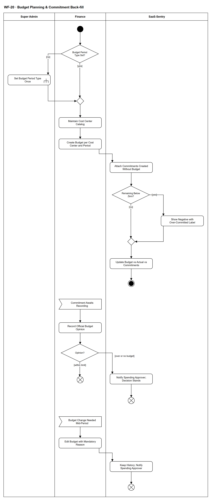

# WF-20 — Budget Planning & Commitment Back-fill

> **Loại:** Workflow hỗ trợ của MF-8 · **Phiên bản:** 1.2 — 10/10/2026 · **Trạng thái:** Mới ở v3.0 (08/10/2026); chờ Owner/GVHD review
>
> Sơ đồ là **dẫn xuất** từ quyết định Owner (`QĐ`) và BRD hiện hành; khi khác nhau, `QĐ` → BRD thắng. Quyết định trong sơ đồ là của Owner, **chưa** phải xác nhận của GVHD/hội đồng.

## 1. Mục đích và phạm vi

Mô tả việc **lập ngân sách theo Cost Center và kỳ** và hai hệ quả bắt buộc: khoản cam kết tạo trước khi có ngân sách được **gắn ngược** khi ngân sách ra đời (số còn lại được phép âm, không bị che), và **hàng đợi ghi nhận** của Finance sau mỗi quyết định chi.

**Phạm vi:** Loại kỳ ngân sách, danh mục Cost Center, lập ngân sách, gắn ngược khoản cam kết, hiển thị còn lại âm, ghi nhận ý kiến chính thức của Finance.

**Không nằm trong sơ đồ này:** Tạo khoản cam kết khi duyệt chi (→ MF-2, WF-09); chuyển cam kết thành chi phí theo hóa đơn và báo cáo kỳ (→ WF-19).

## 2. Tệp

| Tệp | Vai trò |
| --- | --- |
| [WF-20-budget-planning-commitment-backfill.drawio](WF-20-budget-planning-commitment-backfill.drawio) | Nguồn draw.io chỉnh sửa được (sinh từ spec) |
| [WF-20-budget-planning-commitment-backfill.drawio.png](WF-20-budget-planning-commitment-backfill.drawio.png) | Bản xuất PNG, nhúng sẵn nguồn draw.io |
| [WF-20.json](../specs/WF-20.json) | **Nguồn canonical** — sửa ở đây rồi chạy `python tools/flowkit.py build` từ `Docs/Diagrams` |

## 3. Nguồn nghiệp vụ

| Mã | Nội dung dùng trong sơ đồ |
| --- | --- |
| `FR-5.1, OI-11b` | Kỳ ngân sách một loại cho toàn tổ chức, mặc định quý |
| `FR-3.1, OI-04, QĐ-52b` | Finance quản lý danh mục Cost Center Unit/Company |
| `FR-5.8a, INV-18, QĐ-30b` | Khoản cam kết khi chưa có ngân sách; gắn ngược; còn lại được phép âm |
| `FR-3.14 (3), QĐ-29b, SoD-8` | Finance ghi nhận sau duyệt; vượt/chưa có ngân sách chỉ thông báo |
| `FR-5.13, QĐ-60a` | Ngân sách so trên chi phí thực chịu |

## 4. Tác nhân, kích hoạt, điều kiện

| Làn (tiếng Anh trên hình) | Tác nhân | Trách nhiệm trong sơ đồ |
| --- | --- | --- |
| Super Admin | Super Admin | Đặt loại kỳ ngân sách một lần (cấu hình) |
| Finance | Finance (một người) | Danh mục Cost Center, ngân sách, ghi nhận ý kiến |
| SaaS-Sentry | SaaS-Sentry | Gắn ngược, tính còn lại, thông báo |

- **Kích hoạt:** Đầu kỳ ngân sách (hoặc khi Finance lập ngân sách cho một Cost Center); luồng phụ: một khoản cam kết mới chờ ghi nhận.
- **Tiền điều kiện:** Phòng ban đã có; Cost Center Unit 1–1 với phòng (WF-01).
- **Hậu điều kiện:** Ngân sách của Cost Center và kỳ có hiệu lực; mọi khoản cam kết của kỳ đó đã gắn vào ngân sách; khoản cam kết mới có ý kiến chính thức của Finance.

## 5. Cách đọc ký hiệu

| Ký hiệu | Nghĩa |
| --- | --- |
| Hình tròn đặc | Bắt đầu hoạt động (initial node) |
| Hình chữ nhật bo góc | Hành động (action) của tác nhân ở làn chứa nó |
| Hình chữ nhật bo góc có ký hiệu cây đinh ba ở góc | Gọi workflow con (call behavior) — mã workflow ghi trong nhãn |
| Hình thoi có chữ | Rẽ nhánh; mỗi cạnh ra mang điều kiện trong ngoặc vuông `[...]` |
| Hình thoi nhỏ không chữ | Hợp nhánh (merge) |
| Hình năm cạnh lõm | Chờ một sự kiện từ bên ngoài luồng (accept event) |
| Vòng tròn kép đặc | Kết thúc toàn bộ hoạt động (activity final) |
| Vòng tròn có dấu nhân | Kết thúc riêng nhánh đó, các nhánh khác vẫn chạy (flow final) |
| Dây có cung nhảy | Hai dây giao nhau nhưng **không** nối với nhau |

Luồng chính đi từ trên xuống ở làn Finance và hệ thống. Luồng phụ bắt đầu bằng ký hiệu chờ sự kiện *Commitment Awaits Recording* — có thể xảy ra bất cứ lúc nào, độc lập với việc lập ngân sách. Ngoại lệ biểu diễn: luồng phụ bắt đầu bằng sự kiện không có cạnh vào là một lần xử lý độc lập, kết thúc nhánh chính không hủy chúng — cách đọc nội bộ đã ghi ở [tools/README.md mục 7](../tools/README.md#7-ngoại-lệ-biểu-diễn-đã-chấp-nhận-ghi-10102026), không phải bằng chứng hình tuân thủ đầy đủ UML 2.5.

## 6. Bảng node

| ID | Loại | Nhãn trên hình | Ý nghĩa | Làn / người thực hiện | Quy tắc |
| --- | --- | --- | --- | --- | --- |
| `st` | Nút bắt đầu | — | — | Finance | — |
| `d_period` | Rẽ nhánh | Budget Period Type Set? | Kỳ ngân sách (tháng/quý/năm) là một loại cho toàn tổ chức, đặt một lần. | Finance | `OI-11b`, `FR-5.1` |
| `c_period` | Gọi workflow con | Set Budget Period Type Once | Super Admin đặt loại kỳ ngân sách, mặc định quý; không đổi được khi đã có ngân sách. Đây là cấu hình, không phải phê duyệt. | Super Admin | `OI-11b`, `FR-8.2`, `SoD-1`, → `WF-03` |
| `m_period` | Hợp nhánh | — | — | Finance | — |
| `a_cc` | Hành động | Maintain Cost Center Catalog | Finance tạo, sửa, ngừng dùng Cost Center: Unit (1–1 với phòng) và Company. Tách/gộp phòng ⟹ Cost Center mới, cũ ngừng dùng, lịch sử giữ nguyên. Không tạo Cost Center giữ chỗ. | Finance | `FR-3.1`, `OI-04`, `QĐ-52b`, `FR-9.7` |
| `a_bud` | Hành động | Create Budget per Cost Center and Period | Ngân sách tính trên chi phí thực chịu. Không tạo ngân sách hạn mức 0 để giữ chỗ. Mỗi (Cost Center, kỳ) tối đa **một** ngân sách; lập trùng bị từ chối — muốn đổi thì sửa ngân sách đã có (QĐ-62m). *Suy ra* từ FR-5.8a và INV-18 (*ngân sách của đúng Cost Center và kỳ đó*). | Finance | `FR-5.1`, `FR-5.13`, `QĐ-60a`, `FR-5.8a` |
| `s_back` | Hành động | Attach Commitments Created Without Budget | Hệ thống tự gắn mọi khoản cam kết “Chưa có ngân sách” của đúng Cost Center và kỳ đó vào ngân sách vừa lập; ghi Audit Trail sự kiện gắn. Từ đây chúng được tính vào cam kết đang giữ. | SaaS-Sentry | `FR-5.8a`, `INV-18`, `QĐ-30b` |
| `d_neg` | Rẽ nhánh | Remaining Below Zero? | Còn lại = ngân sách − thực chi − cam kết đang giữ có âm không. | SaaS-Sentry | `FR-5.8a` |
| `s_neg` | Hành động | Show Negative with Over-Committed Label | Hiển thị số âm kèm nhãn “đã cam kết vượt hạn mức”, không làm tròn về 0, không ẩn; báo cáo nêu phần vượt đến từ cam kết tạo trước khi có ngân sách. | SaaS-Sentry | `FR-5.8a` |
| `m_neg` | Hợp nhánh | — | — | SaaS-Sentry | — |
| `s_upd` | Hành động | Update Budget vs Actual vs Commitments | Snapshot ngân sách và báo cáo dùng ngay ngân sách mới: ngân sách · thực chi · cam kết đang giữ · còn lại. | SaaS-Sentry | `FR-5.1`, `FR-3.14` |
| `end_ok` | Kết thúc hoạt động | — | Ngân sách của kỳ có hiệu lực. | SaaS-Sentry | — |
| `e_com` | Chờ sự kiện | Commitment Awaits Recording | Một khoản cam kết vừa được tạo sau quyết định chi (MF-2, WF-09) vào hàng đợi ghi nhận của Finance. | Finance | `FR-5.8`, `INV-16` |
| `a_rec` | Hành động | Record Official Budget Opinion | Finance ghi ý kiến chính thức trên khoản cam kết: Trong hạn mức / Vượt hạn mức / Chưa có ngân sách, kèm ngân sách, thực chi, còn lại. Bước có SLA riêng, không nằm trên đường chờ cấp phát. | Finance | `FR-3.14`, `QĐ-29b`, `SoD-8` |
| `d_op` | Rẽ nhánh | Opinion? | Ý kiến Finance ghi. | Finance | — |
| `s_ntf` | Hành động | Notify Spending Approver; Decision Stands | Vượt hạn mức hoặc chưa có ngân sách: chỉ thông báo Người duyệt chi; không hoàn tác quyết định, không dừng cấp phát; khoản cam kết vẫn đang giữ. | SaaS-Sentry | `FR-3.14`, `FR-5.14` |
| `ff_ok` | Kết thúc nhánh (flow final) | — | Đã ghi nhận trong hạn mức. | Finance | — |
| `ff_ntf` | Kết thúc nhánh (flow final) | — | Đã ghi nhận và thông báo. | SaaS-Sentry | — |
| `e_edit` | Chờ sự kiện | Budget Change Needed Mid-Period | Luồng phụ: Finance cần tăng hoặc giảm ngân sách của một Cost Center trong kỳ đang chạy. | Finance | `QĐ-62m` |
| `a_edit` | Hành động | Edit Budget with Mandatory Reason | Finance sửa số tiền ngân sách, lý do bắt buộc; ghi Audit Trail. | Finance | `FR-5.1`, `QĐ-62m`, `FR-8.3` |
| `s_hist` | Hành động | Keep History; Notify Spending Approver | Hệ thống giữ lịch sử các lần sửa; snapshot đã chụp lúc quyết **giữ nguyên** (FR-3.14); báo cáo hiện hạn mức hiện tại và trước đó; báo Người duyệt chi. Kỳ không bị khóa (QĐ-62m). | SaaS-Sentry | `QĐ-62m`, `FR-3.14` |
| `ff_edit` | Kết thúc nhánh (flow final) | — | Ngân sách mới có hiệu lực từ lúc sửa. | SaaS-Sentry | — |

## 7. Bảng chuyển tiếp

| Từ → tới | Nhãn điều kiện | Điều kiện | Kết quả |
| --- | --- | --- | --- |
| `st` → `d_period` | — | — | Sang Budget Period Type Set? |
| `d_period` → `c_period` | `[no]` | Chưa đặt loại kỳ ngân sách | Super Admin đặt một lần |
| `d_period` → `m_period` | `[yes]` | Đã đặt | Đi tiếp |
| `c_period` → `m_period` | — | — | Sang — |
| `m_period` → `a_cc` | — | — | Sang Maintain Cost Center Catalog |
| `a_cc` → `a_bud` | — | — | Sang Create Budget per Cost Center and Period |
| `a_bud` → `s_back` | — | — | Sang Attach Commitments Created Without Budget |
| `s_back` → `d_neg` | — | — | Sang Remaining Below Zero? |
| `d_neg` → `s_neg` | `[yes]` | Cam kết gắn ngược vượt hạn mức vừa lập | Hiện số âm kèm nhãn |
| `d_neg` → `m_neg` | `[no]` | Còn lại không âm | Đi tiếp |
| `s_neg` → `m_neg` | — | — | Sang — |
| `m_neg` → `s_upd` | — | — | Sang Update Budget vs Actual vs Commitments |
| `s_upd` → `end_ok` | — | — | Sang — |
| `e_com` → `a_rec` | — | — | Sang Record Official Budget Opinion |
| `a_rec` → `d_op` | — | — | Sang Opinion? |
| `d_op` → `ff_ok` | `[within limit]` | Trong hạn mức | Kết thúc |
| `d_op` → `s_ntf` | `[over or no budget]` | Vượt hạn mức hoặc chưa có ngân sách | Thông báo Người duyệt chi |
| `s_ntf` → `ff_ntf` | — | — | Sang — |
| `e_edit` → `a_edit` | — | — | Sang Edit Budget with Mandatory Reason |
| `a_edit` → `s_hist` | — | — | Sang Keep History; Notify Spending Approver |
| `s_hist` → `ff_edit` | — | — | Sang — |

Số đếm: **22 node · 21 cạnh · 3 rẽ nhánh**; giao cắt dây: **0**.

## 8. Happy path

1. `st` — —
2. `d_period` — Budget Period Type Set?: Kỳ ngân sách (tháng/quý/năm) là một loại cho toàn tổ chức, đặt một lần.
3. `a_cc` — Maintain Cost Center Catalog: Finance tạo, sửa, ngừng dùng Cost Center: Unit (1–1 với phòng) và Company. Tách/gộp phòng ⟹ Cost Center mới, cũ ngừng dùng, lịch sử giữ nguyên. Không tạo Cost Center giữ chỗ.
4. `a_bud` — Create Budget per Cost Center and Period: Ngân sách tính trên chi phí thực chịu. Không tạo ngân sách hạn mức 0 để giữ chỗ. Mỗi (Cost Center, kỳ) tối đa **một** ngân sách; lập trùng bị từ chối — muốn đổi thì sửa ngân sách đã có (QĐ-62m). *Suy ra* từ FR-5.8a và INV-18 (*ngân sách của đúng Cost Center và kỳ đó*).
5. `s_back` — Attach Commitments Created Without Budget: Hệ thống tự gắn mọi khoản cam kết “Chưa có ngân sách” của đúng Cost Center và kỳ đó vào ngân sách vừa lập; ghi Audit Trail sự kiện gắn. Từ đây chúng được tính vào cam kết đang giữ.
6. `d_neg` — Remaining Below Zero?: Còn lại = ngân sách − thực chi − cam kết đang giữ có âm không.
7. `s_upd` — Update Budget vs Actual vs Commitments: Snapshot ngân sách và báo cáo dùng ngay ngân sách mới: ngân sách · thực chi · cam kết đang giữ · còn lại.
8. `end_ok` — —: Ngân sách của kỳ có hiệu lực.

## 9. Nhánh thay thế / if-else

- **Chưa đặt loại kỳ** — `d_period` → `c_period` → `m_period`. Super Admin đặt một lần qua WF-03.
- **Ghi nhận trong hạn mức** — `e_com` → `a_rec` → `d_op` → `ff_ok`. Không thông báo thêm.
- **Sửa ngân sách giữa kỳ** — `e_edit` → `a_edit` → `s_hist` → `ff_edit`. Lý do bắt buộc, lịch sử giữ, snapshot cũ không đổi (QĐ-62m).

## 10. Nhánh lỗi / từ chối và cách kết thúc

- **Cam kết vượt ngân sách vừa lập** — `d_neg` → `s_neg` → `m_neg`. Hiện số âm, không làm tròn 0.
- **Vượt hoặc chưa có ngân sách khi ghi nhận** — `d_op` → `s_ntf` → `ff_ntf`. Quyết định và cấp phát giữ nguyên.

## 11. Liên hệ với sơ đồ khác

- Cấp trên: `MF-8`
- Liên quan: `MF-2`, `WF-09` (tạo khoản cam kết), `WF-19` (báo cáo kỳ), `WF-03` (cấu hình)
- User flow: `UF-11`, `UF-19`
- `WF-03` — gọi/chuyển tại node `c_period`

## 12. Giới hạn và vấn đề còn mở

- (ĐÃ CHỐT · DOI-102, QĐ-62m) Sửa ngân sách giữa kỳ: được, lý do bắt buộc, giữ lịch sử, snapshot cũ không đổi, báo Người duyệt chi — vẽ ở luồng phụ `e_edit`.
- (ĐÃ CÓ NGUỒN · DOI-103, suy ra) Mỗi (Cost Center, kỳ) tối đa một ngân sách — suy ra từ FR-5.8a, INV-18 (*ngân sách của đúng Cost Center và kỳ đó*); BRD chưa ghi thành câu riêng; ràng buộc duy nhất ở ERD (QĐ-59e).
