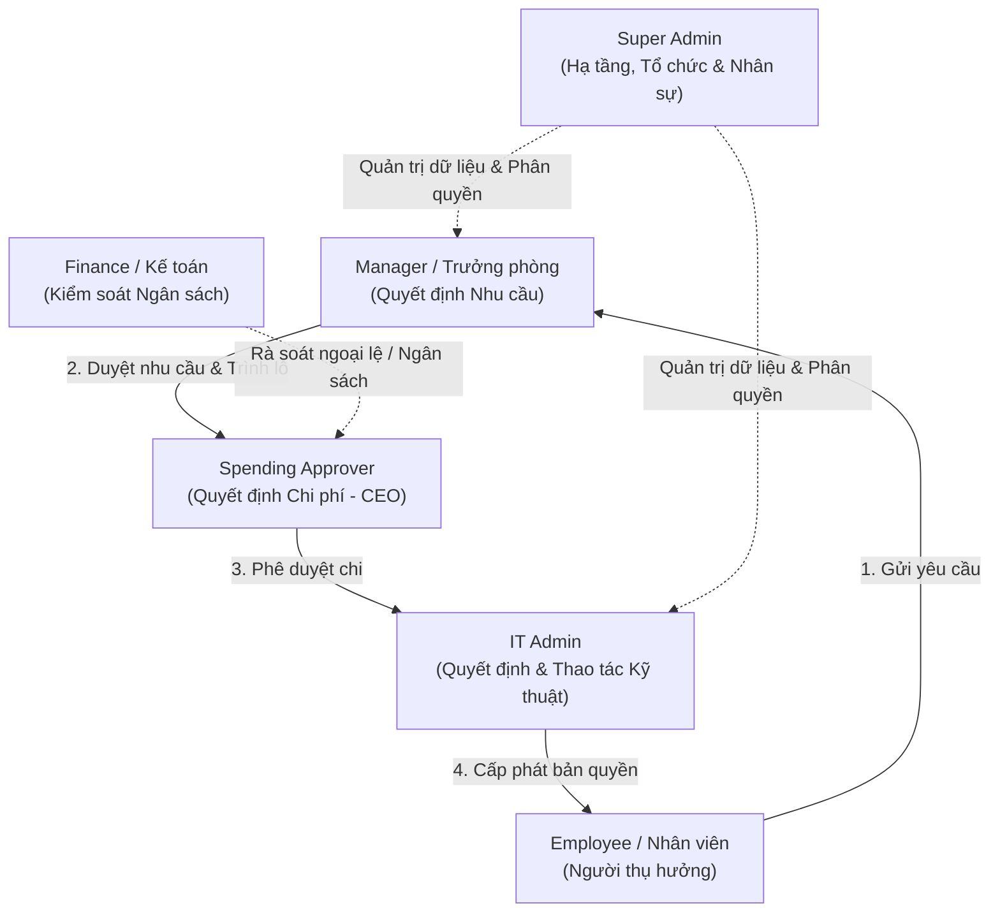
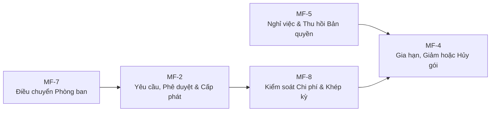

# SaaS-Sentry — Tài Liệu Đặc Tả Tổng Quan Dự Án (Project Overview)

> **Mục đích tài liệu:** Bản tổng hợp đặc tả tổng quan toàn diện về đề tài **SaaS-Sentry**, giúp bất kỳ Lập trình viên hoặc AI Agent nào khi tiếp cận repository Frontend (`FE-dev-main`) có thể nắm bắt nhanh chóng, chính xác bản chất nghiệp vụ, phạm vi, cơ cấu tổ chức, quy tắc phân quyền, các luồng hoạt động chính và kiến trúc hệ thống mà không cần đọc lại hàng nghìn trang tài liệu gốc trong thư mục `docs/`.
> 
> **Phiên bản nghiệp vụ cơ sở:** Đồng bộ theo **BRD v3.54**, Sổ quyết định dự án **`QĐ-01` → `QĐ-89`**, Bộ sơ đồ nghiệp vụ hiện hành **v2.1** (`QĐ-87i`), và User Stories **v0.15** (tháng 10/2026).

---

## 1. Tuyên Ngôn & Tôn Chỉ Cốt Lõi Dự Án

### 1.1. Tên đề tài & Định vị
- **Tên dự án:** **SaaS-Sentry**
- **Đề tài:** Hệ thống Quản trị Bản quyền Phần mềm & Tối ưu Chi phí Công nghệ (*Software License Management & IT Cost Optimization / SaaS Management System*).
- **Loại hình:** Hệ thống quản trị nội bộ doanh nghiệp (*Internal Enterprise Management System*), phục vụ doanh nghiệp công nghệ quy mô vừa (100 – 500 nhân sự, sử dụng từ 15 – 40 phần mềm SaaS/bản quyền).

### 1.2. Phát biểu vấn đề (Problem Statement)
> Doanh nghiệp quy mô vừa ngày càng phụ thuộc vào các phần mềm thuê bao (SaaS) và bản quyền số. Tuy nhiên, thông tin về **hợp đồng, quyền truy cập (seat/license), mức độ sử dụng thực tế và chi phí** lại nằm phân tán ở nhiều phòng ban và nhiều nguồn dữ liệu rời rạc, không một ai nắm giữ bức tranh toàn cảnh.
>
> **Hệ quả là:** Doanh nghiệp trả tiền cho những tài khoản/license không ai dùng, bỏ lỡ thời điểm vàng để đàm phán tối ưu hợp đồng trước hạn gia hạn tự động, không quy được chi phí về đúng đơn vị thụ hưởng, và nhân viên tự ý mua/sử dụng công cụ bên ngoài không qua kiểm soát (*Shadow IT*).

### 1.3. Bốn câu hỏi cốt lõi SaaS-Sentry trả lời
Hệ thống là nguồn chân lý duy nhất (Single Source of Truth) trong doanh nghiệp trả lời 4 câu hỏi:
1. **Đang mua phần mềm gì?** (Danh mục, gói dịch vụ, hợp đồng, chi phí cam kết, hạn chót báo hủy).
2. **Ai đang được cấp quyền?** (Ai đang giữ seat/license nào, từ bao giờ, theo quyết định phê duyệt nào).
3. **Quyền đó có thực sự được sử dụng không?** (Bằng chứng telemetry/usage thực tế có giá trị pháp lý và kỹ thuật, loại bỏ báo động giả).
4. **Chi phí thuộc về phòng ban nào?** (Gắn trách nhiệm tài chính 100% về đúng Trung tâm chi phí - Cost Center của phòng ban sở hữu).

---

## 2. Nỗi Đau Doanh Nghiệp (WHY - 5 Pain Points) & Chỉ Số Thành Công

Dự án xuất phát từ 5 nỗi đau nghiệp vụ có bản chất khác nhau, đòi hỏi 5 nhóm giải pháp chuyên biệt:

| Mã | Pain Point | Bản chất vấn đề | Cách giải quyết của SaaS-Sentry | Chỉ số đo lường (KPI / Tiêu chí) |
| :--- | :--- | :--- | :--- | :--- |
| **PP-1** | **Ghost Seats (Suất lãng phí)** | Vấn đề **dữ liệu**: Không ai biết ai đang dùng gì. 36% license mua bị bỏ không. | Thu thập dữ liệu sử dụng từ nhà cung cấp & bộ thu thập thiết bị; đối chiếu qua **8 cổng lọc** để ra khuyến nghị thu hồi có bằng chứng minh bạch. | **KPI-3**: Tỷ lệ suất hoạt động / tổng suất đã mua.<br/>**KPI-5**: Tỷ lệ khuyến nghị bị quản lý bác bỏ.<br/>**TC-2**: Số báo động giả = 0 trên fixture test. |
| **PP-2** | **Auto-renewal ngoài ý muốn** | Vấn đề **thời điểm**: Nhận ra lãng phí thì hợp đồng đã tự động gia hạn thêm 1 năm. | Cảnh báo sớm tính theo **hạn chót báo hủy** (*cancellation deadline* - thường trước 30-60 ngày) thay vì ngày hết hạn hợp đồng. | **KPI-4**: Số thuê bao gia hạn tự động mà không có quyết định phê duyệt được ghi nhận trước = 0. |
| **PP-3** | **Bất đối xứng thông tin** | Vấn đề **ngôn ngữ chung**: CNTT nói ngôn ngữ kỹ thuật, Tài chính nói ngôn ngữ sổ sách kế toán. | Thiết lập mô hình chi phí chung theo Cost Center; lập ngân sách năm có phiên bản; kiểm tra ngân sách tự động theo **chi phí thực chịu** (*actual cost* gồm thuế không khấu trừ). | **KPI-1**: Tỷ lệ chi tiêu phần mềm nằm trong danh mục và ngân sách đã phê duyệt. |
| **PP-4** | **Shadow IT (Mua ngoài luồng)** | Vấn đề **tầm nhìn & kiểm soát**: Nhân viên tự quẹt thẻ mua công cụ vì cần gấp. | Đối soát sao kê/hóa đơn thẻ công ty để phát hiện chi tiêu lạ; phân tích rủi ro và đưa vào quy trình thẩm định hợp thức hóa hoặc từ chối. | **KPI-1**: Giảm thiểu chi tiêu SaaS phát sinh ngoài danh mục quản lý. |
| **PP-5** | **Quy trình chính thức quá chậm** | Vấn đề **quy trình vận hành**: Xin cấp phần mềm mất nhiều ngày, làm động lực nảy sinh PP-4. | Chuẩn hóa luồng yêu cầu (Request Stepper), đo lường thời hạn (SLA), quản lý phê duyệt theo lô (*batching*), tích hợp cấp phát tự động (SCIM/Connector). | **KPI-2**: Thời gian trung vị từ khi gửi yêu cầu đến khi tác vụ cấp phát hoàn tất. |

---

## 3. Phạm Vi Dự Án (WHAT - In Scope vs. Out of Scope)

### 3.1. Đối tượng quản lý trong hệ thống
1. **SaaS trả phí bên ngoài:** Các dịch vụ đám mây có thu phí định kỳ (Figma, GitHub, Notion, Zoom, Google Workspace,...).
2. **Phần mềm thương mại có bản quyền:** Mua bản quyền vĩnh viễn (*perpetual license*) hoặc có khóa kích hoạt (*license key*).
3. **Phần mềm/dịch vụ nội bộ:** Các hệ thống do doanh nghiệp tự xây dựng (chỉ quản lý danh mục, Business Owner, quyền sử dụng và chi phí nội bộ; không tích hợp API cấp phát tự động).

### 3.2. Những ranh giới KHÔNG THUỘC phạm vi (Out of Scope / Non-Goals quan trọng)
Agent cần nắm rõ các nguyên tắc này để tránh sinh mã sai lệch nghiệp vụ:
- ❌ **Không quản lý phần mềm/SaaS miễn phí bên ngoài:** Không có loại yêu cầu, phân loại hay nhánh nghiệp vụ riêng cho SaaS miễn phí bên ngoài (`QĐ-82n`). Request thiếu đơn giá được coi là *Chưa đủ dữ liệu giá*, không tự động chuyển thành "miễn phí".
- ❌ **Không tự động chặn hay thu hồi seat dựa trên cảnh báo:** Hệ thống không bao giờ tự ý ngắt quyền của nhân viên. Quyết định thu hồi luôn phải do **Trưởng phòng** (Manager) hoặc **Người duyệt chi** xác nhận (`SoD-6`).
- ❌ **Không thay thế hệ thống ERP / Mua sắm tổng quát:** Hệ thống chỉ quản trị chi tiêu phần mềm/SaaS. Đàm phán thương lượng hợp đồng và thanh toán ngân hàng diễn ra ngoài hệ thống.
- ❌ **Không phải hệ thống ITSM:** Tính năng *Báo lỗi phần mềm* chỉ dành riêng cho quyền/tài khoản SaaS mà chính nhân viên đó đang được cấp, không phải hệ thống ticket hỗ trợ CNTT tổng quát.
- ❌ **Không có phân hệ HR / Nhân sự trong hệ thống:** SaaS-Sentry không tích hợp hay xây dựng HRM. Phòng nhân sự chỉ là đơn vị ban hành căn cứ văn bản bên ngoài. Super Admin là người nhập dữ liệu nhân sự dựa trên căn cứ văn bản đó (`QĐ-87a`).
- ❌ **Không hỗ trợ tài khoản dùng chung (Shared Accounts):** Mỗi người dùng bắt buộc dùng một tài khoản công ty và một seat riêng biệt (`QĐ-75`). Không có khái niệm chia sẻ mật khẩu giữa nhiều người.
- ❌ **Quyền riêng tư tuyệt đối (Privacy First):** Không theo dõi thiết bị cá nhân (BYOD). Bộ thu thập trên máy công ty chỉ đo lường công cụ AI/SaaS trong danh mục cho phép (*allowlist*), phân tích tại máy, chỉ gửi về kết quả tối thiểu (phút hoạt động, nhãn công việc). **Tuyệt đối không thu thập IP, nội dung chat, prompt, secret, mã nguồn, ảnh màn hình hay phím bấm** (`QĐ-74`).

---

## 4. Cơ Cấu Tổ Chức & 6 Vai Trò (WHO & RBAC)

### 4.1. Cấu trúc tổ chức
Mô hình tổ chức của SaaS-Sentry được thiết kế theo cấu trúc phẳng:
$$\text{Công ty} \longrightarrow \text{Phòng ban (1 cấp phẳng)} \longrightarrow \text{Nhân sự}$$
- Mỗi nhân sự tại một thời điểm thuộc về **đúng một** phòng ban (`INV-20`).
- Mỗi phòng ban có **đúng một** Trưởng phòng (Manager) có hiệu lực (`INV-19`).
- **Phòng ban có trước, Cost Center có sau** (`QĐ-87d`): Finance tạo Cost Center `Unit` gắn 1-1 với phòng ban đã có. Nếu phòng ban chưa có Cost Center, hệ thống coi là *Cấu hình tài chính chưa hoàn tất* và chặn các nghiệp vụ phát sinh chi phí.
- Mỗi gói phần mềm/thuê bao (Subscription) thuộc về **đúng một phòng ban sở hữu**; chi phí quy về phòng sở hữu 100%, không chia tỷ lệ theo người dùng (`QĐ-89a`).

### 4.2. Sáu vai trò người dùng & Phân tách trách nhiệm (Separation of Duties - SoD)



1. **Employee (Nhân viên):**
   - Người thụ hưởng cuối cùng.
   - Gửi yêu cầu cấp phần mềm (cá nhân hoặc theo nhóm tối đa 10 người cùng phòng).
   - Theo dõi trạng thái, nhận license key/tài khoản, chủ động hoàn trả seat khi không còn nhu cầu, báo lỗi khi phần mềm không hoạt động.
   - **Ràng buộc:** Không bao giờ được tự duyệt yêu cầu của chính mình (`SoD-4`).

2. **Manager (Trưởng phòng):**
   - Vai trò được **hệ thống tự động suy ra** từ việc cá nhân đang là Trưởng phòng có hiệu lực (không gán thủ công).
   - **Quyết định nhu cầu:** Xác nhận nhân viên có thực sự cần phần mềm hay không, gắn dòng kế hoạch ngân sách, gom các đơn hợp lệ để **trình duyệt chi theo lô** (*batch submission*).
   - Rà soát tài khoản không hoạt động (*Ghost seats*) của bộ phận mình: Ra quyết định Giữ, Thu hồi, hoặc Miễn trừ có thời hạn.
   - Lập đề xuất ngân sách phần mềm năm của bộ phận (`BM-10`).
   - Xác nhận bàn giao dữ liệu khi nhân viên trong phòng chuyển công tác hoặc nghỉ việc.

3. **Spending Approver (Người duyệt chi - Thường là CEO/CTO):**
   - Đúng một người giữ quyền tối cao về tài chính cho toàn tổ chức.
   - **Quyết định chi phí:** Phê duyệt đơn mua mới, gia hạn, nâng cấp gói, hoặc các đơn phát sinh chi phí.
   - Duyệt hoặc từ chối phiên bản ngân sách năm của các phòng ban.
   - Có thẩm quyền quyết định ngoại lệ (*override*) cho các đơn vượt định mức hoặc ngoài ngân sách kèm lý do giải trình.
   - Duyệt bước nhu cầu khi chính Trưởng phòng là người gửi đơn.

4. **Finance (Đại diện Phòng Tài chính / Kế toán):**
   - Đúng **một tài khoản cá nhân** đại diện làm đầu mối chuyên môn tài chính trong hệ thống (`QĐ-82m`).
   - Lập và thẩm tra phiên bản ngân sách năm từ đề xuất của các Trưởng phòng.
   - **Rà soát bắt buộc** các Request có kết quả kiểm tra ngân sách là ngoại lệ (`HIGH_VALUE`, `INSUFFICIENT_BUDGET`,...) trước khi chuyển tới Người duyệt chi.
   - Nhập dữ liệu hóa đơn, quản lý chi phí thực chịu (bao gồm thuế không khấu trừ), quản lý cam kết chi tiêu (*commitments*), thực hiện đóng kỳ kế toán và phát hành báo cáo định kỳ.
   - **Ràng buộc:** Finance **không** có quyền quyết định duyệt chi hay từ chối đơn (`SoD-3`), không tự đóng Request.

5. **IT Admin (Quản trị viên Công nghệ):**
   - Quản lý danh mục phần mềm tiêu chuẩn, gói dịch vụ, cấu hình kỹ thuật, kho license key.
   - Đánh giá **cổng mức kiểm soát** đối với phần mềm mới (*Đầy đủ / Một phần / Không kiểm soát được* - phần mềm không kiểm soát được sẽ bị IT từ chối ngay từ cổng kỹ thuật).
   - **Thực thi kỹ thuật:** Thực hiện cấp phát tài khoản, bàn giao thông tin đăng nhập, hoặc thu hồi bản quyền theo các phòng ban được Super Admin phân công phụ trách.
   - Giám sát bộ thu thập dữ liệu (collector), nhập dữ liệu sử dụng (usage import), điều tra phát hiện ứng dụng lạ (*Shadow IT*).
   - **Ràng buộc:** IT Admin không sửa hồ sơ nhân viên, không ghi sự kiện nhân sự, không có quyền duyệt nhu cầu hay duyệt chi (`SoD-5`).

6. **Super Admin (Quản trị viên Hệ thống Cấp cao):**
   - Đúng một tài khoản quản trị kỹ thuật cao nhất.
   - Quản lý tài khoản đăng nhập, cấu hình hệ thống, phân công IT Admin phụ trách từng phòng.
   - Quản trị cơ cấu tổ chức (tạo phòng ban, chỉ định Trưởng phòng, người kế nhiệm).
   - Quản trị hồ sơ nhân viên và **ghi nhận sự kiện nhân sự** (onboarding, điều chuyển, nghỉ việc) dựa trên **căn cứ văn bản có thẩm quyền ngoài hệ thống** (`QĐ-87a`).
   - **Ràng buộc:** Super Admin không tham gia vào luồng gửi/duyệt đơn, không cấp/thu hồi seat, không tạo ngân sách, và không tự duyệt/thao tác trên hồ sơ của chính mình (`SoD-1`).

---

## 5. Năm Luồng Hoạt Động Nghiệp Vụ Cốt Lõi (5 Main Flows)

Hệ thống được vận hành xoay quanh 5 luồng giá trị chính (được chuẩn hóa tại `docs/Diagrams/main-workflows-activity-diagram/`):



1. **MF-2: Access Request, Approval & Provisioning (Yêu cầu, Phê duyệt & Cấp phát):**
   - Nhân viên gửi đơn -> Trưởng phòng thẩm tra nhu cầu -> Hệ thống tự động phân loại & kiểm tra ngân sách -> Finance rà soát nếu vượt ngưỡng/ngoại lệ -> Người duyệt chi phê duyệt trên snapshot chi phí thực chịu -> Hệ thống tự động ghi nhận khoản cam kết (*Commitment*) -> IT Admin thực hiện cấp phát seat và bàn giao cho nhân viên.

2. **MF-7: Department Transfer & Access Adjustment (Điều chuyển & Điều chỉnh quyền):**
   - Super Admin ghi nhận sự kiện điều chuyển theo quyết định nhân sự -> Trưởng phòng mới rà soát toàn bộ các phần mềm nhân viên đang giữ trong vòng 5 ngày làm việc.
   - Thuê bao và seat **không** đi theo nhân viên sang phòng mới (`QĐ-89b`): Seat cũ được thu hồi về phòng cũ, phòng mới nếu cần sẽ tạo Request cấp mới trên thuê bao của phòng mới.

3. **MF-5: Offboarding & Access Reclaim (Nghỉ việc & Thu hồi Bản quyền):**
   - Super Admin ghi nhận sự kiện nghỉ việc kèm căn cứ -> Kích hoạt quy trình bàn giao dữ liệu có người xác nhận cụ thể -> Tại thời điểm hiệu lực, hệ thống yêu cầu khóa tài khoản công ty/thiết bị trước hoặc đồng thời với việc hủy gán seat ở nhà cung cấp -> Giải phóng seat về kho bản quyền để tái sử dụng.

4. **MF-8: Period Software Cost Control & Attribution (Kiểm soát Chi phí & Khép kỳ Kế toán):**
   - Finance nhập hóa đơn thực tế và sao kê thanh toán -> Đối soát tự động 3 chiều (Hóa đơn - Bản ghi mua/Hợp đồng - Khoản cam kết) -> Ghi nhận dòng thuế và chênh lệch tỷ giá -> Quy kết chi phí 100% về phòng ban sở hữu thuê bao -> Đóng sổ kỳ kế toán và phát hành báo cáo tài chính bất biến.

5. **MF-4: Subscription Renewal, Reduction or Cancellation (Gia hạn, Giảm số lượng hoặc Hủy gói):**
   - Hệ thống quét cảnh báo tính từ **Hạn chót báo hủy** -> IT Admin tổng hợp báo cáo sử dụng thực tế và đề xuất phương án -> Người duyệt chi quyết định (Gia hạn nguyên trạng / Giảm bớt số seat lãng phí / Hủy hẳn hợp đồng) -> Đây là thời điểm cốt lõi để hiện thực hóa số tiền tiết kiệm từ việc thu hồi Ghost Seats thành dòng tiền thật.

---

## 6. Cơ Chế Phát Hiện Lãng Phí (Rule Engine) & Bộ Thu Thập Dữ Liệu

### 6.1. Bốn mức độ phát hiện lãng phí (Ghost Seat Rules)
- **G1 (Unassigned Seats):** Suất bản quyền đã mua từ nhà cung cấp nhưng đang bỏ trống trong kho, chưa từng được cấp phát cho ai.
- **G2 (Orphaned / Offboarded Seats):** Suất bản quyền vẫn đang được gán cho nhân viên đã nghỉ việc hoặc đã chuyển sang bộ phận khác.
- **G3 (Inactive Users):** Nhân viên được cấp license nhưng không có hoạt động trong khoảng thời gian quy định ($N$ ngày liên tục, ví dụ 30/60/90 ngày tùy loại ứng dụng).
- **G4 (License Downgrade / Low Activity):** Nhân viên đang giữ license trả phí cao cấp (ví dụ Figma Editor) nhưng thực tế chỉ thực hiện các thao tác xem cơ bản, có thể hạ cấp xuống gói miễn phí (Figma Viewer) để tiết kiệm chi phí.

### 6.2. Tám cổng lọc loại trừ (Exclusion Gates)
Để đảm bảo tôn chỉ **Số lượng báo động giả = 0** (`TC-2`), hệ thống kiểm tra qua 8 cổng lọc trước khi phát khuyến nghị lãng phí:
1. *Cổng nhân sự mới:* Nhân viên mới onboard dưới $N$ ngày.
2. *Cổng nghỉ phép dài hạn:* Nhân viên đang trong chế độ thai sản, nghỉ ốm dài ngày được ghi nhận chính thức.
3. *Cổng tài khoản dịch vụ (Service Account):* Tài khoản chạy bot, CI/CD, tự động hóa.
4. *Cổng miễn trừ có thời hạn:* Đã được Trưởng phòng phê duyệt miễn trừ thu hồi trước đó.
5. *Cổng độ phủ dữ liệu (Coverage Window):* Dữ liệu log thu thập được chưa đủ dài để đưa ra kết luận.
6. *Cổng danh tính chưa khớp:* Chưa xác thực được chắc chắn email log thuộc về ai.
7. *Cổng ứng dụng liên lạc/nền:* Không áp dụng luật không hoạt động tùy tiện cho các ứng dụng chạy ngầm.
8. *Cổng xác nhận rà soát:* Đang nằm trong đợt rà soát chờ xử lý.

---

## 7. Lớp Trí Tuệ Nhân Tạo (AI Copilot / Assistant)

Tuân thủ nghiêm ngặt nguyên tắc: **Backend tạo sự thật; AI giúp diễn giải sự thật; Con người đưa ra quyết định.** AI trong SaaS-Sentry chỉ đóng vai trò hỗ trợ đọc hiểu thông tin nhanh hơn, tuyệt đối không tự đưa ra quyết định nghiệp vụ hay thay đổi cơ sở dữ liệu (`QĐ-49e`, `QĐ-78`).

Hai tính năng AI được cam kết triển khai:
1. **AI Assistant tóm tắt hàng đợi phê duyệt (Dành cho Manager & Spending Approver):**
   - Đọc các yêu cầu cấp quyền (Access Request) đang chờ chính người dùng duyệt, tóm tắt ngắn gọn: ai xin, công cụ gì, chi phí bao nhiêu, mục đích là gì.
   - Mỗi dòng tóm tắt bắt buộc kèm liên kết mở trực tiếp đơn gốc để người dùng tự kiểm chứng.
2. **AI Assistant soạn bản nháp báo cáo chi phí (Dành cho Finance):**
   - Đọc các chỉ số tài chính đã được Backend tính toán sẵn (ngân sách, thực chi, cam kết mở, tiết kiệm).
   - Sử dụng cơ chế thẻ Fact (`{{fact:F001}}`) để sinh văn bản giải trình tự nhiên mà không bao giờ bịa đặt hay làm tròn sai lệch số tiền.

---

## 8. Kiến Trúc Kỹ Thuật Frontend Web (`FE-dev-main`)

Codebase Frontend được xây dựng nhằm hiện thực hóa trọn vẹn nghiệp vụ nói trên, tuân thủ các quy chuẩn khắt khe:

### 8.1. Công nghệ nền tảng
- **Core Framework:** React 19 & React Router 7 (Framework Mode, SPA Client Rendering).
- **Build Tool & Styling:** Vite 8, Tailwind CSS 4, Lucide React Icons.
- **Server State & API Contract:** TanStack Query 5, Orval 8 (tự động sinh TypeScript API client từ file chuẩn `openapi/openapi.yaml`).
- **Testing:** Vitest, Testing Library, MSW (Mock Service Worker), Faker.
- **Package Manager:** pnpm (tuân thủ `pnpm-lock.yaml`).

### 8.2. Ranh giới kiến trúc phân tầng (Architecture Boundaries)
```text
app/routes       -> Tầng điều hướng (URL controller mỏng, bảo vệ bởi RoleGuard)
    ↓
app/features     -> Tầng tính năng nghiệp vụ theo từng Role Dashboard
    ↓
app/entities     -> Tầng thực thể nghiệp vụ dùng chung (user, license, request, budget)
    ↓
app/shared       -> Tầng hạ tầng dùng chung (i18n, API client, UI primitives, utils)
```

### 8.3. Kiến trúc Cắt dọc theo Phân hệ Nghiệp vụ (Vertical Slice Architecture)
Mỗi Role Dashboard trong `app/features/dashboard/<role>/` được phân chia thành các thư mục con theo đúng từng phân hệ nghiệp vụ độc lập, ví dụ:
- **Employee:** `overview/`, `software-request/`, `my-software/`, `my-requests/`, `profile-privacy/`.
- **Manager:** `overview/`, `team-requests/`, `team/`, `access-review/`, `ghost-seats/`, `annual-budget/`.
- **Spending Approver:** `overview/`, `queue/`, `annual-budget/`, `exceptions/`, `decisions/`.
- **Finance:** `overview/`, `annual-budget/`, `budget-allocation/`, `budget-questions/`, `commitments/`, `budget-check/`, `period-close/`, `cost-optimization/`, `spend-import/`, `decisions/`.
- **IT Admin:** `overview/`, `provisioning/`, `device-collectors/`, `dept-catalog/`, `optimization/`, `shadow-it/`, `reconciliation/`, `identities/`, `renewals/`, `offboarding/`, `usage-import/`.
- **Super Admin:** `overview/`, `accounts/`, `departments/`, `personnel/`, `reminders/`, `audit/`, `transfer/`, `settings/`.

### 8.4. Các quy chuẩn bất khả xâm phạm cho AI Agent khi lập trình Frontend
1. **Quy chuẩn Đa ngôn ngữ (Zero-Hardcoded-Text Policy):**
   - 100% văn bản giao diện hiển thị phải thông qua hook `useTranslation()` (ví dụ `t('key')`).
   - Cấm tuyệt đối gõ chuỗi tiếng Việt hoặc tiếng Anh cứng vào mã JSX.
   - Mọi key mới phải được bổ sung đồng thời ở cả hai file locale: `app/shared/i18n/locales/vi/` và `app/shared/i18n/locales/en/`.
2. **Giới hạn kích thước file (<= 500 dòng):**
   - Không một file mã nguồn `.tsx` hay `.ts` nào được phép vượt quá 500 dòng code. Phân rã ngay thành các component con, dialog con, hoặc custom hooks khi chạm mốc ~400 dòng.
3. **Bảo mật phân quyền RBAC đa tầng:**
   - Mọi route dashboard phải bọc trong `<RoleGuard requiredRole="...">`. Khi truy cập sai vai trò hoặc chưa đăng nhập, lập tức chuyển hướng hoặc chặn với màn hình **403 Forbidden**.
4. **Quy tắc Import & Barrel Export:**
   - Các consumer bên ngoài chỉ import thông qua Barrel Index (`index.ts`) của Role, không bao giờ import sâu vào các thư mục con (`views/`, `components/`) của Role khác.

---

## 9. Danh Mục Tài Liệu Tham Chiếu Gốc (Source of Truth References)

Khi cần tra cứu sâu hơn về từng nghiệp vụ chi tiết, tham khảo các tài liệu tương ứng tại thư mục `docs/`:

| Lĩnh vực tra cứu | Tài liệu nguồn |
| :--- | :--- |
| **Đặc tả nghiệp vụ chi tiết toàn diện (BRD)** | [`docs/Requiments/BRD - HỆ THỐNG QUẢN TRỊ BẢN QUYỀN PHẦN MỀM & TỐI ƯU CHI PHÍ CÔNG NGHỆ.md`](file:///c:/fe_capstone/docs/Requiments/BRD%20-%20H%E1%BB%86%20TH%E1%BB%90NG%20QU%E1%BA%A2N%20TR%E1%BB%8A%20B%E1%BA%A2N%20QUY%E1%BB%80N%20PH%E1%BA%A6N%20M%E1%BB%80M%20%26%20T%E1%BB%90I%20%C6%AFU%20CHI%20PH%C3%8D%20C%C3%94NG%20NGH%E1%BB%86.md) |
| **Định nghĩa phạm vi & Nghiệp vụ (WHY/WHAT/WHO)** | [`docs/Requiments/Định nghĩa phạm vi & nghiệp vụ.md`](file:///c:/fe_capstone/docs/Requiments/%C4%90%E1%BB%8Bnh%20ngh%C4%A9a%20ph%E1%BA%A1m%20vi%20&%20nghi%E1%BB%87p%20v%E1%BB%A5.md) |
| **Sổ quyết định dự án (`QĐ-01` → `QĐ-89`)** | [`docs/Decisions/project-decisions.md`](file:///c:/fe_capstone/docs/Decisions/project-decisions.md) |
| **Bộ sơ đồ nghiệp vụ hiện hành (Context, FDD, Main Flows)** | [`docs/Diagrams/index.md`](file:///c:/fe_capstone/docs/Diagrams/index.md) |
| **Danh mục User Stories & Acceptance Criteria** | [`docs/BE-UserStory/user-stories-and-epics.md`](file:///c:/fe_capstone/docs/BE-UserStory/user-stories-and-epics.md) |
| **Quy chuẩn phát triển Frontend cho Coding Agent** | [`FE-dev-main/AGENTS.md`](file:///c:/fe_capstone/FE-dev-main/AGENTS.md) |
| **Đặc tả kiến trúc chi tiết Frontend** | [`FE-dev-main/ARCHITECTURE.md`](file:///c:/fe_capstone/FE-dev-main/ARCHITECTURE.md) |
